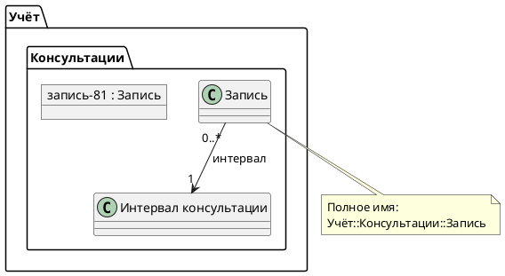

:::note[TL;DR]
Классификаторы описывают множества экземпляров с общими признаками. Имена, пространства имён, свойства и экземпляры объясняют, почему классы, акторы, интерфейсы, компоненты и узлы можно читать как элементы одной UML-модели.
:::

**Элемент** (`Element`) — самое общее понятие метамодели UML. У элемента могут быть владелец, вложенные элементы, комментарии и отношения. **Именованный элемент** (`NamedElement`) может иметь имя; различимость имён определяется пространством имён, а не глобальной уникальностью во всём проекте.

**Пространство имён** (`Namespace`) организует именованные элементы. Пакет — частый пример пространства имён, но им могут быть и другие элементы модели. Полное имя строится из вложенных пространств имён: `Учёт::Заказы::Заказ`.

:::tip[Определение]{icon="starlight"}
**Классификатор** — элемент, который описывает множество экземпляров с общими структурными или поведенческими характеристиками.
:::

Классификаторами являются классы, акторы, варианты использования, интерфейсы, компоненты, узлы, артефакты, типы данных и сигналы. У них могут быть имя, признаки, обобщения, экземпляры и отношения. В метамодели признаки называются `features`. Объект, линия жизни и конкретная запись — экземпляры, а не классификаторы.

**Кооперация** (`Collaboration`) также является классификатором. Она описывает совместную работу ролей для достижения цели и может быть использована, когда нужно отделить роли во взаимодействии от конкретных классов, которые эти роли исполняют.

Классификатор может быть абстрактным и не иметь непосредственных экземпляров. Свойство или операция являются признаками классификатора. Видимость, абстрактность и типизация — свойства модели, а не только элементы оформления.

Один фрагмент модели одновременно показывает пространство имён, классификаторы и их экземпляр:

Эта страница нужна как справка при чтении спецификации и инструмента. Типы признаков, свойства, параметры и значения продолжены в [отдельной статье](/notation/types-properties-and-values), а поведенческие элементы — в справке о [поведении, событиях и вызовах](/notation/behaviors-events-and-calls). Для построения предметной модели начинайте не с метамодели, а со [словаря](/modelling/domain-and-vocabulary), затем переходите к [концептуальной диаграмме классов](/notation/conceptual-class-diagrams).
