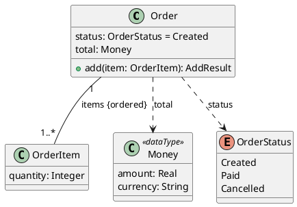

:::note[TL;DR]
Тип ограничивает допустимые значения элемента, свойство описывает структуру классификатора, параметр связывает поведение с входами и выходами, а спецификация значения задаёт конкретное значение или выражение. Вместе они образуют одну систему, используемую на разных UML-диаграммах.
:::

Рассмотрим небольшой фрагмент модели заказа:



Каждая часть этой записи использует несколько общих понятий UML. Разберём её справа налево: сначала типы значений, затем свойства и их кратности, после этого параметры операции и значения по умолчанию.

## Определить допустимые значения

В записи `total: Money` имя после двоеточия обозначает **тип** (`Type`). Тип задаёт множество допустимых значений и доступных над ними операций. Свойство `total` не может содержать произвольный объект: его значение должно соответствовать `Money`.

Класс тоже является типом. `OrderItem` описывает экземпляры с собственной идентичностью и жизненным циклом, поэтому позицию заказа можно отличить от другой позиции с теми же данными. **Тип данных** (`DataType`), напротив, описывает значения без собственной идентичности: две денежные суммы равны, если совпадают их существенные части.

Простейшие значения задают **примитивные типы** (`PrimitiveType`), например `Boolean`, `Integer`, `Real`, `String` и `UnlimitedNatural`. Их внутренняя структура в модели не раскрывается. Конкретный набор библиотечных типов зависит от используемой модельной библиотеки, поэтому типы проекта следует определять явно.

Для `status` нужен закрытый набор вариантов. Его задаёт **перечисление** (`Enumeration`):

```text
enum OrderStatus {
  Created
  Paid
  Cancelled
}
```

`Created` является литералом перечисления (`EnumerationLiteral`) и значением `OrderStatus`, а не отдельным состоянием автомата или подклассом заказа.

Все элементы, способные ссылаться на тип, наследуют общий смысл **типизированного элемента** (`TypedElement`). К ним относятся свойства, параметры операций, переменные, контакты действий и параметры деятельностей. Благодаря этому запись `имя: Тип` читается одинаково в разных частях модели.

## Понять роль свойства

`status`, `items` и `total` являются признаками `Order`. **Признак** (`Feature`) принадлежит классификатору и описывает его структурную или поведенческую характеристику. Свойства относятся к структурным признакам, операция `add` — к поведенческим.

**Свойство** (`Property`) одновременно является типизированным элементом и структурным признаком. В нашем фрагменте `items` записано как атрибут класса, но та же метамодель свойства используется для конца ассоциации с `OrderItem`. Выбор представления зависит от того, требуется ли отдельно показать связь двух классификаторов.

В других контекстах свойство может быть:

- атрибутом класса;
- концом ассоциации;
- частью или ссылочной ролью внутренней структуры;
- свойством стереотипа.

Поэтому похожая запись ещё не определяет роль элемента. Владелец, агрегация и участие в ассоциации показывают, является ли свойство обычным атрибутом, концом связи или внутренней частью. Для свойства дополнительно задаются видимость, производность, значение по умолчанию, упорядоченность, уникальность и переопределение.

## Ограничить количество значений

Запись `items: OrderItem[1..*]` говорит не только о типе. Диапазон является **кратностью** и требует хотя бы одну позицию в заказе. Общий `MultiplicityElement` задаёт нижнюю и верхнюю границы для свойств, параметров, контактов и других элементов.

| Запись | Смысл |
| --- | --- |
| `1` | ровно одно значение |
| `0..1` | значение может отсутствовать |
| `*` или `0..*` | любое число значений |
| `1..*` | одно или больше значений |

Свойство `{ordered}` уточняет, что порядок позиций значим. Характеристика `unique` определяет допустимость повторов. Вместе они различают множество, упорядоченное множество, мультимножество и последовательность.

Кратность не описывает условность поведения. `0..1` у свойства допускает отсутствие значения, тогда как защитное условие определяет, будет ли выполнен переход или шаг. Знак `*` в верхней границе обозначает неограниченное натуральное число (`UnlimitedNatural`), но не утверждает, что экземпляров фактически бесконечно много.

## Передать значение поведению

Операция `add(item: OrderItem): AddResult` получает одну позицию и возвращает результат. `item` — **параметр** (`Parameter`) направления `in`, а `AddResult` — тип возвращаемого параметра.

| Направление | Смысл |
| --- | --- |
| `in` | значение передаётся вызываемому поведению |
| `out` | значение создаётся поведением и возвращается вызывающей стороне |
| `inout` | входное значение может быть заменено выходным |
| `return` | возвращаемый результат операции или поведения |

Параметры операции описывают контракт вызова. Параметры реализующего поведения описывают данные конкретного выполнения; их направления, типы и кратности должны быть совместимы с операцией.

Во время выполнения метод может использовать переменную `newTotal: Money`. **Переменная** (`Variable`) хранит значение внутри поведения или структурированного узла. Она не становится свойством `Order`: после завершения выполнения эта область и её локальные значения больше не существуют.

## Задать начальное или вычисляемое значение

В записи `status: OrderStatus = Created` литерал `Created` задаёт значение по умолчанию. UML представляет его через **спецификацию значения** (`ValueSpecification`): общее понятие для значения, заданного напрямую или вычисляемого выражением.

Спецификацией могут быть:

- логический, целый, вещественный или строковый литерал;
- литерал `null`;
- ссылка на спецификацию экземпляра;
- выражение на выбранном языке;
- интервал или временное выражение.

Значения используются не только по умолчанию. Они появляются в аргументах, ограничениях, защитных условиях и других свойствах модели. **Непрозрачное выражение** (`OpaqueExpression`) хранит тело и указанный язык, например OCL или естественный язык. Оно сообщает, как записано вычисление, но не превращает текст в новое свойство класса.

Теперь исходный фрагмент читается целиком: `Order` владеет типизированными свойствами, `items` содержит упорядоченную непустую коллекцию `OrderItem`, `status` начинается со значения `Created`, а операция `add` принимает позицию и возвращает `AddResult`.

## Проверка модели

- тип соответствует смыслу хранимого или передаваемого значения;
- класс не используется вместо типа данных только ради одинакового изображения;
- атрибут, конец ассоциации и внутренняя часть различаются по роли;
- кратность выражает допустимое число значений, а не один наблюдаемый пример;
- направление параметра соответствует контракту вызова;
- значение по умолчанию совместимо с типом и кратностью элемента.

## В модели

Классификаторы и пространства имён введены в [общей статье](/notation/classifiers-and-namespaces). Свойства и операции конкретизируются на [технической диаграмме классов](/notation/technical-class-diagrams), экземпляры и слоты — на [диаграмме объектов](/notation/object-diagrams), параметры и контакты деятельности — в [расширенной нотации деятельности](/notation/activity-advanced), выражения ограничений — в материале об [OCL](/notation/constraints-and-ocl).
