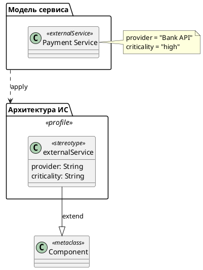

:::note[TL;DR]
Профиль расширяет UML для конкретной области, не меняя базовые метаклассы языка. Стереотип уточняет элемент, помеченное значение (`tagged value`) хранит дополнительное свойство, а ограничение задаёт правило применения.
:::

Стереотип применяют к уже существующему элементу модели: `«externalService»` к компоненту, `«entity»` к классу или `«executable»` к артефакту. Он не создаёт новый базовый элемент UML и не исправляет неверно выбранную связь.

**Помеченное значение** (`tagged value`) — свойство, которое стереотип добавляет элементу. Например:

```text
«externalService»
Payment Service
{provider = "Bank API"}
{criticality = "high"}
```

## Диаграмма профиля

Профиль — специальный пакет, который содержит стереотипы, их свойства и ограничения. На диаграмме профиля профиль обозначают ключевым словом `«profile»`, стереотип — `«stereotype»`, а элемент UML, который расширяется, — как метакласс `«metaclass»`.

**Расширение** (`Extension`) связывает стереотип с метаклассом и определяет, к каким элементам можно применять стереотип. Например, стереотип `«externalService»` может расширять `Component`, а `«audited»` — `Class` и `Operation`.

Кратность конца расширения со стороны стереотипа определяет обязательность применения. Нижняя граница `0` означает обычное необязательное расширение, а `1` — обязательное: каждый экземпляр расширяемого метакласса в области применённого профиля должен иметь этот стереотип. Обязательное расширение меняет правила допустимости модели, поэтому его используют только как намеренное ограничение предметной области.

Стереотип может обобщать другой стереотип и наследовать его свойства и ограничения, но не обычный класс. К одному модельному элементу можно применить несколько совместимых стереотипов, если каждый из них расширяет подходящий метакласс и их ограничения не противоречат друг другу.



## Применение профиля

Определение профиля само по себе не изменяет пользовательскую модель. **Применение профиля** (`ProfileApplication`) связывает пакет модели с профилем и делает его стереотипы доступными для элементов этого пакета. Применение относится к пакету: вложенные элементы используют профиль в пределах заданной области модели.

На приведённой диаграмме пакет `Модель сервиса` применяет профиль `Архитектура ИС`; после этого вложенный компонент может использовать определённый в профиле стереотип `«externalService»`.

Перед применением стереотипа проверяют три условия:

1. содержащий элемент находится в области применённого профиля;
2. стереотип расширяет метакласс этого элемента;
3. заполнены обязательные свойства и выполнены ограничения стереотипа.

Удаление применения профиля делает основанные на нём применения стереотипов недопустимыми. Поэтому профиль следует подключать на устойчивой границе модели, а не независимо для каждой диаграммы.

## Представление стереотипа и значений

Применённый стереотип обычно показывают ключевым словом в кавычках `«externalService»`. Несколько стереотипов можно перечислить вместе либо отдельно, если рядом нужно показать их свойства. Значения свойств записывают в отделении элемента или в фигурных скобках:

```text
«externalService»
Payment Service
{provider = \"Bank API\", criticality = \"high\"}
```

Дополнительный значок или оформление может сокращать повторяющуюся запись, но легенда должна однозначно связывать его со стереотипом. Оформление не заменяет применение стереотипа в самой модели.

Профиль используют, когда такие договорённости повторяются в нескольких моделях или их должен проверять инструмент. Для одной учебной диаграммы обычно достаточно явно объяснённого стереотипа и короткого набора значений.

## В модели

Стереотип уточняет решение после определения [архитектурной роли](/modelling/software-architecture-and-layers) или [предметного правила](/modelling/business-rules-and-constraints). Его свойства используют общую семантику [типов и значений](/notation/types-properties-and-values), а профиль применяют к пакету согласно правилам [импорта и пространств имён](/notation/package-diagrams). Перед применением проверьте базовый элемент и отношение в [общей статье об отношениях](/notation/relations).
