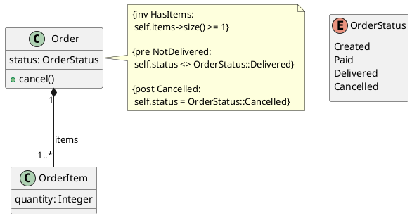

:::note[TL;DR]
Ограничение фиксирует правило модели. Его можно записать понятным естественным языком, а OCL использовать, когда важное правило нужно выразить однозначнее.
:::

Ограничение показывают в фигурных скобках у класса, свойства, ассоциации, перехода или другого элемента. Например, `{оплаченный заказ нельзя редактировать}`. Это не декоративная подпись: правило должно быть проверяемым и согласованным с моделями, где оно проявляется.

Кратность, защитное условие, предусловие, постусловие и ограничения множества обобщений также выражают правила. Одно правило полезно показывать там, где оно лучше всего читается, а затем связывать с требованиями и сценариями, а не переписывать дословно на каждой диаграмме.

## Контекст и виды ограничений

**OCL** (`Object Constraint Language`) — типизированный язык выражений без побочных эффектов. Выражение OCL вычисляет значение, но не изменяет модель, не вызывает внешнюю операцию с эффектом и не задаёт порядок выполнения.

Контекст определяет элемент, относительно которого читаются имя `self` и доступные признаки:

```text
context Order
inv HasItems:
  self.items->size() >= 1

context Order::cancel()
pre NotDelivered:
  self.status <> OrderStatus::Delivered

context Order::cancel()
post Cancelled:
  self.status = OrderStatus::Cancelled
```

`inv` задаёт инвариант корректного состояния, `pre` — условие допустимого вызова операции, `post` — условие после её успешного выполнения. Имя ограничения после ключевого слова необязательно, но помогает ссылаться на правило из требований и проверок.

Ограничения читаются в контексте тех элементов, свойства и операции которых они проверяют:



Для свойства используют `init` для начального значения и `derive` для правила вычисления производного значения. `body` задаёт результат операции-запроса, когда её тело выражено непосредственно на OCL.

## Навигация и коллекции

Через точку переходят от объекта к его свойству или операции: `self.customer.status`. Навигация по многозначному свойству возвращает коллекцию. Операции коллекций вызывают через стрелку `->`:

```text
context Order
inv PositiveQuantities:
  self.items->forAll(item | item.quantity > 0)

inv HasAvailableItem:
  self.items->exists(item | item.product.available)

inv UniqueProducts:
  self.items->collect(item | item.product)->isUnique(p | p.id)
```

Основные виды коллекций различаются порядком и повторами:

| Тип | Порядок | Повторы |
| --- | --- | --- |
| `Set(T)` | незначим | запрещены |
| `OrderedSet(T)` | значим | запрещены |
| `Bag(T)` | незначим | разрешены |
| `Sequence(T)` | значим | разрешены |

Часто используемые операции: `select` отбирает элементы, `reject` исключает их, `collect` преобразует, `exists` проверяет существование, `forAll` — условие для всех элементов, `includes` — наличие значения. Тип результата зависит от исходной коллекции и выбранной операции.

## Условия и локальные имена

Условное выражение вычисляет только выбранную ветвь:

```text
if self.discountCode = null
then self.total
else self.total * 0.9
endif
```

`let` вводит локальное имя и позволяет не повторять выражение:

```text
let activeItems = self.items->select(item | not item.cancelled) in
  activeItems->size() >= 1
```

Локальное имя действует только внутри следующего за `in` выражения и не добавляет свойство моделируемому классу.

## Предыдущее состояние

В постусловии суффикс `@pre` обращается к значению до выполнения операции:

```text
context Order::add(item: OrderItem)
post ItemAdded:
  self.items->size() = self.items@pre->size() + 1
```

`@pre` имеет смысл только там, где определены состояния до и после выполнения, прежде всего в постусловии. Без него `self.items` обозначает значение после выполнения операции.

## Типы, `null` и ошибочные значения

`oclIsKindOf(T)` проверяет принадлежность значения типу `T` или его специализации, `oclIsTypeOf(T)` — ровно типу `T`, а `oclAsType(T)` рассматривает значение как указанный совместимый тип.

`null` обозначает отсутствие обычного значения. `invalid` обозначает невозможность корректно вычислить выражение, например деление на ноль или недопустимое приведение типа. Ни одно из них не следует автоматически считать `false`: правило должно явно учитывать допустимое отсутствие значения, а ошибочное вычисление означает, что ограничение нельзя подтвердить.

Кратность `0..1` допускает отсутствие значения, но не отменяет проверку перед навигацией по нему. Для обязательного свойства с кратностью `1` значение `null` нарушает модель.

## Сквозной пример: одна активная запись

Формализуем ограничение [предметной модели консультаций](/notation/conceptual-class-diagrams). Для примера используем английские имена модельных элементов: `ConsultationInterval.bookings : Booking[0..*]` — конец ассоциации с историей, а `Booking.status : BookingStatus[1]` — обязательное свойство. Литералы перечисления: `Created`, `Confirmed`, `Completed`, `Cancelled`.

```text
context ConsultationInterval
inv AtMostOneActiveBooking:
  self.bookings->select(b |
    b.status = BookingStatus::Created or
    b.status = BookingStatus::Confirmed
  )->size() <= 1
```

Сначала навигация возвращает **всю историю** интервала. `select` оставляет активные записи, затем `size` считает только их. Кратность `0..1` у `bookings` дала бы другой результат: запретила бы хранить несколько исторических записей независимо от статуса.

### Проверить выражение на снимках

Каждая строка таблицы описывает отдельный интервал и все его записи; экземпляры в списке различны.

| Снимок истории | Активных | Результат инварианта |
| --- | ---: | --- |
| пусто | 0 | `true` |
| `Cancelled`, `Completed` | 0 | `true` |
| `Cancelled`, `Confirmed` | 1 | `true` |
| `Created`, `Confirmed` | 2 | `false` |
| `Confirmed`, `Confirmed` | 2 | `false` |

При отмене единственной активной записи счётчик уменьшается до нуля; новая запись может появиться, а старая остаётся в истории. Отсутствующий обязательный `status` уже нарушает типизированную модель: такой снимок нужно исправить, а не интерпретировать как ещё одно неактивное состояние.

Для инструментальной проверки создайте эти экземпляры и связи в модели, добавьте ограничение в контексте `ConsultationInterval` и выполните проверку OCL, если редактор её поддерживает. Если вычисление недоступно, пройдите таблицу вручную, проверяя по отдельности результат `select` и `size`. Общие правила OCL определены в [спецификации OMG](https://www.omg.org/spec/OCL/2.4/).

Инвариант описывает допустимое состояние, но не сериализует два конкурентных запроса. [Архитектурное решение](/modelling/project-decisions) должно указать, где атомарно обеспечивается правило; [проверка реализации](/modelling/model-based-testing) — воспроизвести конкурирующие попытки.

## Проверка выражения

- контекст соответствует классу, операции или свойству, к которому относится правило;
- навигация учитывает кратность и возможное отсутствие значения;
- операции над коллекциями соответствуют требуемым порядку и уникальности;
- `@pre` используется только для обращения к состоянию до операции;
- выражение не маскирует `invalid` как обычный отрицательный результат;
- имена типов, свойств, операций и литералов совпадают с моделью.

В учебной модели естественного языка обычно достаточно. OCL нужен, когда правило должно читаться однозначно, проверяться инструментом или использоваться в нескольких связанных представлениях.

## В модели

Источником ограничений служат [бизнес-правила](/modelling/business-rules-and-constraints). Типы, свойства, кратности и значения разобраны в [общей справке](/notation/types-properties-and-values). Инварианты раскрываются на [диаграмме классов](/notation/conceptual-class-diagrams), защитные условия — на [диаграмме деятельности](/notation/activity-diagrams) и [диаграмме состояний](/notation/state-machine-diagrams), предусловия и постусловия — в [спецификации варианта использования](/modelling/use-case-specification).
