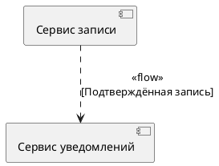

:::note[TL;DR]
**Информационный поток** (`InformationFlow`) показывает, какая информация передаётся между элементами модели на высоком уровне. Он не задаёт порядок операций, протокол доставки или структуру хранения данных.
:::

Информационный поток связывает источник и получателя из допустимых элементов модели: например, акторов, классы, компоненты, порты, интерфейсы, узлы, артефакты, пакеты, узлы деятельности или спецификации экземпляров. Он может перечислять передаваемые **элементы информации** (`information items`): класс, интерфейс, элемент информации, сигнал или компонент — например `Заявку`, `Подтверждение оплаты` или `Отчёт о нагрузке`. Его удобно использовать, когда важно согласовать границы обмена между системами, компонентами или организационными участниками, но преждевременно описывать API и сообщения.

Поток может быть реализован более конкретным отношением: сообщением на диаграмме последовательности, объектным потоком на диаграмме деятельности, соединителем или другим отношением модели, например путём связи в развёртывании. Операция интерфейса может описывать контракт обмена, но сама по себе не реализует информационный поток. Поэтому информационный поток отвечает на вопрос «что передаётся», а не «как, когда и по какому протоколу».

Не подменяйте информационным потоком ассоциацию классов. Ассоциация описывает возможные связи экземпляров, а информационный поток — передачу информации между элементами модели. Для процессной обработки данных обычно яснее использовать [объектный поток](/notation/activity-advanced), а для взаимодействия реализации — [сообщения](/notation/sequence-diagrams).

## В модели

Содержание потока выводится из [архитектуры данных](/modelling/data-architecture), сценариев и границ систем. Его реализацию уточняют на [диаграммах компонентов](/notation/component-diagrams) и [развёртывания](/notation/deployment-diagrams).
