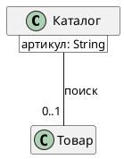
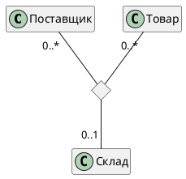
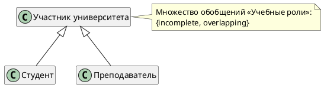
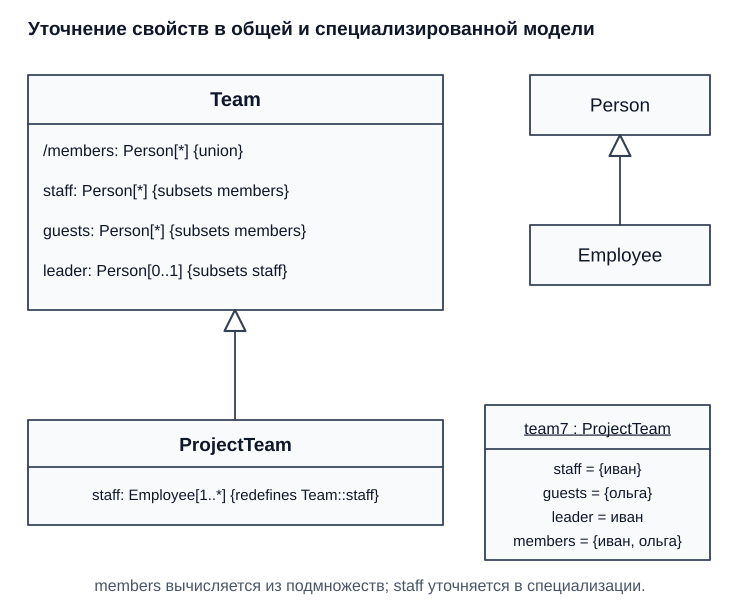

:::note[TL;DR]
Квалификатор, n-арная ассоциация и множество обобщений уточняют конкретное правило. Начинайте с обычных классов, ролей и кратностей; используйте расширение, когда без него теряется существенный смысл.
:::

## Квалификатор: кратность после выбора ключа

Каталог содержит много товаров, но по одному артикулу в данном каталоге можно найти не более одного товара. Квалификатор располагается в маленьком прямоугольнике у конца ассоциации:



`0..1` читается **для фиксированных каталога и значения артикула**, а не как ограничение всего каталога одним товаром. При ключе `A-17` найдётся один товар либо ничего; при другом ключе может найтись другой товар. Одинаковый артикул в разных каталогах не запрещён этим рисунком.

Без квалификатора можно показать `Каталог — 0..* Товар` и записать отдельно `{артикул уникален в пределах каталога}`. Выберите форму, которая лучше объясняет поиск. Прямоугольник квалификатора не является отдельным классом или обязательным индексом БД.

## N-арная ассоциация: зафиксировать остальные концы

Пусть реестр задаёт, на каком складе поставщик вправе хранить конкретный товар. Для каждой пары «поставщик — товар» разрешён максимум один склад; это учебное правило реестра, а не универсальное правило логистики.



Ромб в центре — **ассоциация трёх участников**, а не ромб композиции у целого. Кратность на одном конце читают при фиксированной комбинации экземпляров **всех остальных концов**.

| Конец | Что зафиксировано | Чтение |
| --- | --- | --- |
| Склад `0..1` | один поставщик и один товар | максимум один разрешённый склад |
| Поставщик `0..*` | один товар и один склад | любое число поставщиков |
| Товар `0..*` | один поставщик и один склад | любое число товаров |

Строки `(П1, Т1, С1)` и `(П1, Т2, С2)` допустимы вместе. Строки `(П1, Т1, С1)` и `(П1, Т1, С2)` при разных складах нарушают первое правило.

Три попарные ассоциации не сохранят автоматически разрешённые тройки. При появлении срока действия или собственного жизненного цикла удобнее обычный класс `РазрешениеХранения` с тремя связями и явным ограничением уникальности активного разрешения для пары.

## Владение концом, навигация и направление чтения

Это три разных свойства, которые легко спутать:

| Свойство | Вопрос | Как проверять |
| --- | --- | --- |
| имя роли | как объект участвует в связи? | `студент` у конца `Студент`, `записи` у конца `Запись` |
| навигация | можно ли получить связанные экземпляры в указанном направлении? | стрелка навигации на нужном конце; отсутствие стрелок может означать, что навигация не показана |
| владение концом | где в модели объявлено свойство конца? | в свойствах классификатора либо самой ассоциации |
| направление чтения | как читать подпись ассоциации? | маленький треугольник у имени связи, а не у классификатора |

Например, свойство `Запись::студент : Студент[1]` может быть принадлежащим `Записи` концом ассоциации. Это не делает студента композиционной частью записи: владение **свойством модели** не равно владению **предметным объектом**.

UML допускает точку у конца ассоциации для показа владения концом классификатором на противоположной стороне. В инструменте проверьте владельца свойства и навигацию отдельно; одна стрелка не описывает все эти характеристики. Не дублируйте одно свойство атрибутом и ещё одним независимым концом связи по ошибке.

## Множества обобщений

Полнота и пересечение — независимые вопросы о выбранном наборе специализаций:

| Свойство | Значение |
| --- | --- |
| `complete` | каждый экземпляр общего классификатора входит хотя бы в одну специализацию данного множества |
| `incomplete` | допускается экземпляр общего классификатора вне всех перечисленных специализаций |
| `disjoint` | экземпляр не входит одновременно в несколько специализаций данного множества |
| `overlapping` | такое пересечение допускается, но не обязательно существует |



В этом примере человек может одновременно учиться и преподавать; могут существовать и другие участники. Сочетание `{complete, disjoint}` означало бы совсем другое: каждый участник относится **ровно к одной** из двух специализаций. Не подставляйте его только ради полноты оформления.

Для проверки подготовьте три экземпляра: только студент, одновременно студент и преподаватель, участник без этих ролей. Показанное множество допускает все три. Какие из них запретит `{complete, disjoint}`? Второй — из-за пересечения, третий — из-за неполноты классификации.

## Подмножества, производное объединение и переопределение

Эти свойства уточняют уже объявленные роли, а не вводят новые виды ассоциаций. Возьмём команду `Team`:

- `staff: Person[*]` — штатные участники;
- `guests: Person[*]` — приглашённые участники;
- `/members: Person[*] {union}` — производное объединение участников;
- `leader: Person[0..1] {subsets staff}` — руководитель, выбранный из штатных участников.

У `staff` и `guests` указано `{subsets members}`. Тогда каждое их значение входит в `members`, а `leader` дополнительно входит в `staff`. Само `subsets` не требует, чтобы подмножества были непересекающимися или вместе покрывали всё исходное свойство.



`{union}` у производного свойства требует, чтобы его значения были **в точности объединением значений всех подмножеств**. Такое свойство является производным и доступным только для чтения. Нельзя независимо добавить в `members` ещё одного человека, которого нет ни в одном из подмножеств.

Теперь специализация `ProjectTeam` переопределяет `Team::staff`:

```text
staff: Employee[1..*] {redefines Team::staff}
```

Здесь `Employee` специализирует `Person`. Более узкий тип и нижняя граница `1` уточняют унаследованный контракт: в проектной команде нужен хотя бы один сотрудник. Это **то же переопределяемое свойство в специализированном контексте**, а не второе независимое поле, которое случайно называется `staff`.

Проверим модель на снимках. В примере `иван` — сотрудник, `ольга` — человек:

| Значения одного `ProjectTeam` | Результат |
| --- | --- |
| `staff = {иван}`, `guests = {ольга}`, `leader = иван`, `members = {иван, ольга}` | допустимо |
| тот же состав, но `leader = ольга`, причём ольга не входит в `staff` | нарушено `leader {subsets staff}` |
| тот же состав, но в `members` добавлен пётр, которого нет ни в одном подмножестве | нарушено производное объединение |
| `staff = {}`, `guests = {ольга}`, `leader` отсутствует | нарушена нижняя граница переопределённого `staff` |

Если убрать `{union}`, но сохранить два `{subsets members}`, дополнительные значения в `members` уже не запрещены одним лишь подмножеством. Именно поэтому три ключевых слова нельзя считать взаимозаменяемыми.

## Классификатор видов — powertype

Множество обобщений может ссылаться на **powertype** — классификатор, экземпляры которого взаимно однозначно соответствуют специализациям этого множества. Например, специализациям `Автомобиль` и `Велосипед` классификатора `Транспорт` могут соответствовать экземпляры `автомобильный` и `велосипедный` классификатора `ВидТранспорта`.

Рядом с обозначением множества записывают имя powertype после двоеточия, например `вид : ВидТранспорта`. Это не тип всех транспортных средств: экземпляр автомобиля является экземпляром `Автомобиля`, а соответствующий экземпляр `ВидаТранспорта` представляет **вид**, связанный с этой специализацией.

| Что моделируется | Пример |
| --- | --- |
| обычный экземпляр специализации | `машина42 : Автомобиль` |
| экземпляр powertype, соответствующий специализации | `автомобильный : ВидТранспорта` соответствует классификатору `Автомобиль` |

Обычное перечисление `VehicleKind` с литералом `Car` само по себе не устанавливает такую связь с подклассом `Car`. Powertype полезен для моделей классификаций и метамоделей; в прикладной ИС часто достаточно обычного класса-справочника и явно описанных правил соответствия.

## Проверка и источники

- кратность квалифицированного конца прочитана после выбора ключа;
- n-арная связь проверена на комбинациях остальных концов;
- роль и навигация не подменены направлением чтения;
- ограничения множества обобщений подтверждены экземплярами;
- `subsets` проверено как включение, а `{union}` — как точное объединение;
- переопределённое свойство совместимо с унаследованным по типу и кратности;
- экземпляры powertype отличимы от экземпляров специализаций.

Базовые ассоциации, класс ассоциации и рефлексивная связь — в [концептуальной диаграмме классов](/notation/conceptual-class-diagrams). Свойства концов — в [типах и значениях](/notation/types-properties-and-values). Несколько классификаций и их изменение — в [диаграмме объектов](/notation/object-diagrams#несколько-классификаторов-одного-экземпляра). Точная семантика свойств приведена в 9.5, множеств обобщений и powertype — в 9.7 [UML 2.5.1](https://www.omg.org/spec/UML/2.5.1/).
