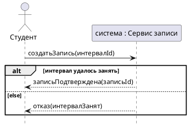

:::note[TL;DR]
Сначала можно показать систему одной линией жизни и согласовать наблюдаемый контракт с актором. Затем раскрыть выполнение выбранной операции внутренними участниками. Это два масштаба диаграммы последовательности, а не два разных вида диаграмм UML.
:::

## Система как чёрный ящик

**Системная диаграмма последовательности** (SSD, System Sequence Diagram) — приём анализа: внутреннее устройство системы скрыто. Системные события называют намерения актора, а ответы — наблюдаемые результаты. Не добавляйте сюда контроллеры, SQL, репозитории и обработчики уведомлений.

Студент уже прошёл внешний вход и выбрал интервал. Для варианта из справочника успешная запись сразу подтверждается; ошибка доставки уведомления не отменяет результат бронирования.

Внешний контракт не утверждает, каким образом обеспечивается единственность активной записи. Однако отказ обязан быть наблюдаемым, а успешный ответ означает, что запись уже сохранена. Идентификатор студента может поступать из контекста подтверждённой личности; актор не получает права подставить чужого владельца.

## Контракт системной операции

| Часть | `создатьЗапись(интервалId)` |
| --- | --- |
| Предусловия | личность студента подтверждена; интервал существует и открыт преподавателем |
| Успех | новая запись относится к этому студенту и интервалу; статус `Подтверждена`; задание уведомления сохранено |
| Конфликт | новой записи и нового задания уведомления нет; существующая история не изменена |
| Инвариант | на интервале не более одной активной записи (`Создана` или `Подтверждена`) |
| Внешний эффект | доставка выполняется позднее и не является условием успешного бронирования |

Доступность интервала не задана предусловием: она может измениться после выбора пользователем. Поэтому конфликт входит в результат операции, а атомарное обеспечение правила относится к реализации.

## Раскрыть одну операцию

Выбор ответственности выполняют на основании [технической модели](/notation/technical-class-diagrams) и ADR. В варианте справочника контроллер передаёт команду сервису приложения; резервирование, запись и outbox фиксируются одной транзакцией.

| Внешнее утверждение | Внутреннее выполнение |
| --- | --- |
| поступил запрос создания | `BookingController.create` вызывает `BookingService.create` |
| интервал удалось занять | `SchedulePort.reserve` атомарно проверяет доступность |
| результат сохранён | `BookingRepository.saveConfirmed` и `NotificationPort.enqueue` выполняются до фиксации общей транзакции |
| получен успешный ответ | `BookingResult` возвращается после фиксации |
| получен конфликт | при неуспешном резервировании нет вызовов сохранения новой записи и постановки уведомления |

Полная внутренняя диаграмма приведена в [успешной последовательности](/notation/sequence-diagrams#сквозной-пример-успешная-запись). Отсутствие ветви конфликта на **успешной трассе** не отменяет её в контракте системы.

В базовой демонстрации лекций новая запись остаётся в `Создана`, а уведомление запрашивается после сохранения через `NotificationChannel`. Это другой согласованный вариант решения. При переносе между вариантами нужно явно изменить постусловие, технические операции и автомат, а не смешивать `saveIfNoActive` с `saveConfirmed` в одной трассе без объяснения.

## Проверка перехода между масштабами

1. Все внешние запросы и ответы внутренней модели сопоставляются с SSD.
2. Новая внутренняя ответственность обоснована требованием, правилом или ADR.
3. Успешный ответ не отправляется до обещанного сохранения.
4. Изменение внутреннего поставщика не меняет внешний контракт без отдельного решения.
5. Вызовы не требуют от актора знать репозитории и внутренние идентификаторы реализации.

SSD полезна при обсуждении требований; внутренняя последовательность — при [распределении ответственности](/modelling/responsibility-and-patterns). Практика — в [задачах по взаимодействиям](/notation/exercises#диаграммы-последовательности).
