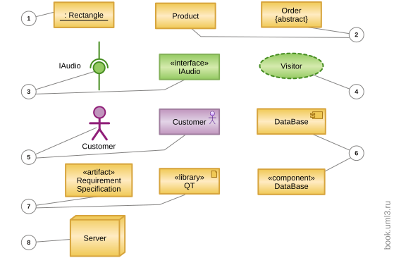
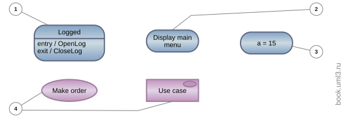
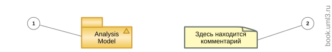

:::note[TL;DR]
Этот раздел даёт общий обзор сущностей UML. Он нужен как справочная точка: многие диаграммы используют разные обозначения, но за ними стоят общие виды элементов модели.
:::

# Из чего состоит UML

Официальная спецификация UML занимает сотни страниц и описывает не только внешний вид диаграмм, но и элементы модели, их свойства, отношения, ограничения и правила нотации. Если возникает спор о смысле элемента или направлении отношения, проверять нужно не картинку из инструмента, а соответствующий раздел спецификации.

Основных типов элементов нотации четыре: фигуры, линии, значки и тексты. Сама нотация достаточно гибкая, но не произвольная: у элементов есть заданная семантика, а у отношений — допустимые направления и способы применения. Инструментальных средств тоже много: какие-то лучше поддерживают UML-семантику, какие-то хуже и требуют большей внимательности при работе с моделью.

Упрощённо UML-модель можно представить как набор элементов и отношений между ними. Диаграмма показывает только выбранную часть этой модели, а не исчерпывает её целиком.

Сущности можно разделить на несколько групп: **структурные**, **поведенческие**, **группирующие** и **аннотационные**:

1. Объект — экземпляр классификатора, у которого есть идентичность, состояние и связи с другими экземплярами.
2. Класс — описание множества объектов с общими атрибутами и операциями.
3. Интерфейс — контракт, который задаёт набор предоставляемых или требуемых возможностей.
4. Кооперация — описание совместной работы ролей для достижения некоторой цели.
5. Действующее лицо — роль, которую внешний по отношению к рассматриваемому субъекту пользователь, система, устройство или организация играет при взаимодействии с ним.
6. Компонент — модульная часть системы, которая инкапсулирует своё содержимое и предоставляет или требует интерфейсы.
7. Артефакт — физическая единица информации, используемая или создаваемая при разработке, поставке или выполнении системы.
8. Узел — вычислительный ресурс, на котором могут размещаться артефакты; узел может быть устройством или средой выполнения.

Структурные сущности

1. Состояние — период в жизненном цикле объекта, в котором объект удовлетворяет некоторому условию, выполняет деятельность или ожидает события.
2. Деятельность — поведение, заданное графом узлов и рёбер, по которым передаются управляющие и объектные токены.
3. Действие — исполняемый узел деятельности, задающий элементарный шаг поведения.
4. Вариант использования — спецификация набора действий, выполняемых субъектом и дающих наблюдаемый результат, значимый для действующего лица или другого заинтересованного лица.

Поведенческие сущности

1. Пакет — группа элементов модели (в том числе пакетов).
2. Заметка или примечание.

Группирующая и аннотационная сущности

## В модели

Сущности UML помогают подобрать представление для терминов из [словаря предметной области](/modelling/domain-and-vocabulary) и [объектов предметной области](/modelling/domain-objects). Общие свойства таких элементов раскрыты в [классификаторах](/reference/classifiers), а выбор нужной диаграммы — в [обзоре диаграмм](/reference/canonical-diagrams).
