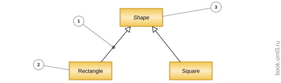
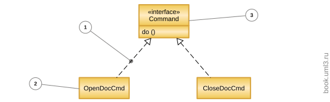

:::note[TL;DR]
Этот раздел описывает основные виды отношений UML. Понимание направлений и смысла отношений важно, потому что похожие линии на диаграммах могут означать разные проектные связи.
:::

Отношения также можно выделить в четыре типа: зависимость, ассоциация, обобщение и реализация:

- **Зависимость** — это наиболее общий тип отношения между двумя сущностями. Отношение зависимости указывает на то, что изменение независимой сущности каким-то образом влияет на зависимую сущность. Графически отношение зависимости изображается в виде пунктирной стрелки (1), направленной от зависимой сущности (2) к независимой (3).
    
    
    
- **Ассоциация** — это наиболее часто используемый тип отношения между сущностями. Отношение ассоциации имеет место, если одна сущность непосредственно связана с другой (или с другими — ассоциация может быть не только бинарной). Графически ассоциация изображается в виде сплошной линии (1) с различными дополнениями, соединяющей связанные сущности.
    
    
    
- **Обобщение** — это отношение между двумя сущностями, одна их которых является частным (специализированным) случаем другой. Графически обобщение изображается в виде сплошной стрелки с треугольником на конце (1), направленной от частного (2) к общему (3). Отношение наследования между классами в объектно-ориентированных языках программирования является типичным примером обобщения.
    
    
    
- Отношение **реализации** указывает, что одна сущность является реализацией другой. Например, класс является реализацией интерфейса. Графически реализация изображается в виде пунктирной стрелки с треугольником на конце (1), направленной от реализующей сущности (2) к реализуемой (3).
    
    
    

# Семантика основных отношений

Большая часть ошибок в UML возникает не из-за того, что студент забыл форму стрелки, а из-за того, что он использует отношение не по его смыслу.

Ассоциация показывает возможные связи между экземплярами классификаторов. Если на диаграмме классов есть ассоциация между `Customer` и `Order`, это значит, что экземпляр клиента может быть связан с экземплярами заказов. Ассоциация сама по себе не говорит, что один класс вызывает метод другого, что в базе данных обязательно будет внешний ключ или что связь реализована через REST-запрос. Всё это может появиться позже на техническом уровне, но в UML-семантике ассоциации этого нет автоматически.

Обобщение показывает отношение общего и специального классификатора. Если `Student` специализирует `Person`, то экземпляр `Student` является также косвенным экземпляром `Person`. На концептуальной модели обобщение стоит использовать только там, где действительно есть отношение “является видом”. Если связь звучит как “содержит”, “использует”, “оформляет”, “проверяет” или “работает с”, скорее всего, нужна не generalization.

Dependency показывает, что один элемент зависит от другого: изменение supplier может повлиять на client. Это очень общее отношение, поэтому у зависимостей много специальных вариантов и ключевых слов. `«use»` показывает использование, `«call»` — вызов операции, `«create»` — создание экземпляров, `«trace»` — трассировку между элементами разных моделей, `«manifest»` — материализацию элемента артефактом, `«deploy»` — развёртывание артефакта на цели развёртывания, `«bind»` — связывание шаблона с параметрами. Пунктирная стрелка похожа, но смысл разный.

Realization связывает спецификацию и реализацию. Самый привычный пример — класс реализует интерфейс. Но шире это отношение показывает, что один элемент модели реализует контракт, заданный другим элементом.

Constraint тоже важно понимать как часть модели. Ограничение не является декоративным комментарием. Если на классе написано `{order.total >= 0}`, это утверждение, которое должно выполняться для корректного состояния модели. Ограничение можно записать естественным языком, формальным выражением или OCL. Главное, что оно должно иметь смысл как правило модели, а не как пояснительная подпись.

## В модели

Отношения выбираются после того, как определены [бизнес-правила и ограничения](/modelling/business-rules-and-constraints) и собрана [концептуальная модель](/modelling/conceptual-model). Их подробное применение к структуре показано на [диаграмме классов](/reference/class-diagrams), а расширения и ограничения — в материале о [стереотипах и помеченных значениях](/reference/stereotypes-tagged-values).
