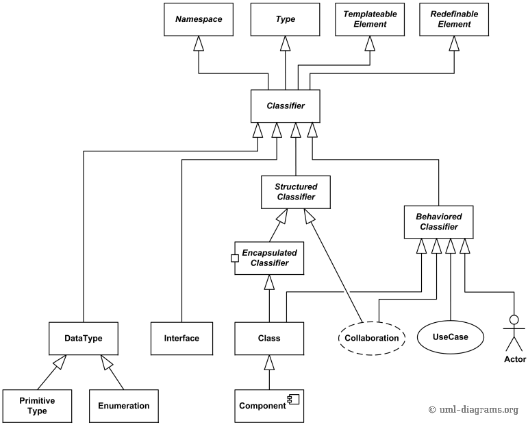

:::note[TL;DR]
Этот раздел вводит классификаторы и их свойства. Классификаторы лежат в основе многих UML-диаграмм, поэтому важно понимать их как описания множеств экземпляров, а не только как отдельные прямоугольники.
:::

# Классификаторы и стереотипы

Чтобы читать разные UML-диаграммы как части одного языка, нужно понимать понятие классификатора. Многие элементы, которые выглядят по-разному, в метамодели UML имеют общие свойства именно потому, что являются классификаторами.

Модель в нотации UML состоит из сущностей и отношений между ними. Часть сущностей является **классификаторами**.

:::tip[Определение]
**Классификатор** — это абстрактный метакласс, описывающий набор элементов, обладающих одинаковыми структурными и/или поведенческими характеристиками.
:::

Часть метамодели классификатора

На схеме метамодели показаны не все возможные классификаторы, но в целом классификатор можно распознать по тому признаку, что он описывает **множество** экземпляров с общими характеристиками. Отдельный объект или отдельное состояние таким классификатором не являются.

Новые базовые виды элементов UML не появляются просто из-за того, что на диаграмме нарисована новая фигура. Если нужно уточнить смысл стандартного элемента под предметную область или технологию, обычно используют профили и стереотипы. Если нужно раскрыть внутреннее устройство уже существующего классификатора, для этого подходит диаграмма внутренней структуры.

Любой классификатор может быть **абстрактным**.

:::tip[Определение]
**Абстрактный классификатор** — это классификатор, который не может иметь непосредственных экземпляров. Имя абстрактного классификатора выделяется *курсивом*.
:::

На практике абстрактные классификаторы дополняются конкретными с помощью обобщения.

# Свойства классификаторов

У классификаторов есть общие свойства, которые встречаются на разных диаграммах: имя, экземпляры, обобщение, абстрактность, видимость, признаки и возможность участия в отношениях. Эти свойства помогают понимать, почему актор, класс, компонент, интерфейс, артефакт и узел имеют разный внешний вид, но во многом подчиняются общим правилам UML.

## Наличие имени

Классификатор обычно имеет имя, по которому его можно отличить от других элементов модели. Формально в UML имя у `NamedElement` может отсутствовать, а требование различимости действует внутри конкретного пространства имён, а не как глобальная уникальность во всей модели. UML-инструменты помогают поддерживать такую дисциплину имён, если в них создавать именно элементы модели, а не только похожие графические фигуры.

## Экземпляры

Классификаторы могут иметь конкретные экземпляры. Например, если на диаграмме использования есть действующее лицо “Менеджер”, то конкретный сотрудник “Васильев В.Н.” может рассматриваться как экземпляр этого актора. Если классификатор специализирует другой классификатор, его экземпляры также являются косвенными экземплярами более общего классификатора.

Имя экземпляра классификатора подчёркивается одинарной сплошной линией. Примеры экземпляров обычно можно увидеть, например, на диаграмме деятельности при работе с объектным потоком или при описании протокола взаимодействия с помощью диаграммы последовательности.

## Расширяемость

Классификатор может участвовать в отношении обобщения с другими классификаторами. Это свойство появляется за счёт того, что классификатор является типом. 

:::tip[Определение]
**Тип** с точки зрения UML — абстрактный метакласс, показывающий набор значений.
:::

При обобщении классификатор в том числе может быть уточнён или переопределён.

Ещё одна возможность расширения — использование шаблонов, поскольку формально любой классификатор их поддерживает.

## Абстрактность

Напомним, что классификатор может быть абстрактным и конкретным. **Абстрактный** классификатор не может иметь прямых экземпляров, и его имя выделяется курсивом. **Конкретный** классификатор, напротив, может иметь прямые экземпляры. При этом абстрактный классификатор может иметь косвенные экземпляры (например, через классификаторы, которые он обобщает).

## Видимость

Классификатор может иметь один из четырёх типов видимости:

- Открытый (`+`);
- Защищённый (`#`);
- Закрытый (`-`);
- Пакетный (`~`).

Несмотря на то, что видимость есть у именованных элементов модели, не везде её полезно показывать. Чаще всего она используется на диаграммах классов для атрибутов, операций и вложенных элементов. Её смысл близок к видимости в объектно-ориентированных языках, но в UML это свойство модели, а не синтаксис конкретного языка программирования.

Если видимость на диаграмме не показана, это не означает автоматически `public` или `private`. Это означает только то, что на текущем уровне детализации видимость не указана явно. Отдельные инструменты могут подставлять значения по умолчанию, но это уже поведение инструмента, а не универсальное правило чтения диаграммы.

# Зачем нужна метамодель

Полную метамодель UML разбирать на этом курсе не нужно. Она большая, подробная и предназначена скорее для разработчиков инструментов, профилей и стандартов. Но несколько базовых понятий полезно знать, потому что они постоянно встречаются в спецификации и помогают понимать, почему UML работает именно так.

Самое общее понятие — `Element`. Почти всё в UML является элементом. У элемента может быть владелец, вложенные элементы, комментарии и связи с другими элементами. Поэтому UML-модель — это не плоский набор фигур, а структурированный набор элементов.

Чуть более конкретное понятие — `NamedElement`. Это элемент, у которого может быть имя. Важно слово “может”: имя в UML не всегда обязательно. Например, состояние может быть безымянным, и два безымянных состояния всё равно будут разными состояниями. Но в учебной и проектной практике именовать элементы почти всегда полезно, иначе модель быстро становится нечитаемой.

Следующее важное понятие — `Namespace`. Пространство имён определяет, где имя элемента должно быть различимо. Простая аналогия — package или namespace в языках программирования. Но в UML это шире: пространство имён помогает организовать не только кодовую структуру, но и модель в целом.

Одно из центральных понятий UML — `Classifier`. Классификатор описывает множество экземпляров с общими свойствами. Классификаторами являются классы, акторы, use cases, компоненты, узлы, артефакты, интерфейсы, типы данных и сигналы. Это объясняет, почему такие разные на вид элементы в спецификации часто обсуждаются через общие свойства: у них могут быть имена, обобщения, признаки, экземпляры и типы.

У классификатора есть `Feature`, то есть признак. Атрибут класса — это не просто строка текста внутри прямоугольника, а feature. Операция — тоже feature. Порт компонента — тоже feature. Когда мы настраиваем атрибут, операцию или порт в UML-инструменте, мы меняем свойства модели, а не просто редактируем подпись на картинке.

Наконец, есть `Relationship`. Это общее понятие для отношений между элементами модели. Ассоциация, зависимость, обобщение, реализация, include, extend, template binding, manifestation и deployment — всё это отношения, но с разной семантикой.

Метамодель нужна не для того, чтобы заучивать названия метаклассов. Она нужна, чтобы понимать, где заканчивается картинка и начинается модельный смысл.

## В модели

Понятие классификатора становится практическим после [словаря предметной области](/modelling/domain-and-vocabulary) и выбора [объектов предметной области](/modelling/domain-objects). Для классов, интерфейсов и их признаков продолжайте с [диаграммы классов](/reference/class-diagrams), а для ролей и пользовательских целей — с [диаграммы использования](/reference/usecase-diagrams).
