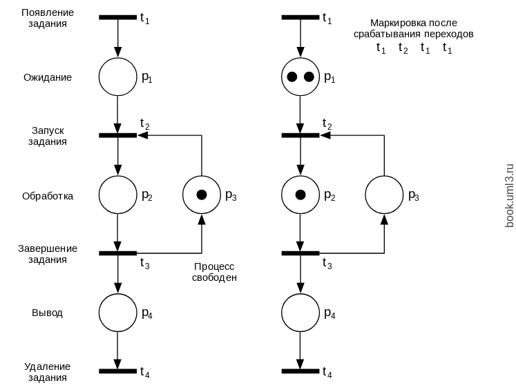

:::note[TL;DR]
Этот раздел описывает диаграмму деятельности и её семантику выполнения. Диаграмма деятельности полезна для моделирования процессов, сценариев и потоков управления или объектов.
:::

# Сети Петри

Перед описанием диаграммы деятельности полезно сделать небольшое отступление к формальным моделям выполнения. Диаграмма деятельности в UML использует токенную семантику: выполнение можно понимать как перемещение токенов по узлам и рёбрам графа. Это похоже на идеи сетей Петри, но UML activity diagram не нужно сводить к классической сети Петри один к одному.

:::tip[Определение]
**Сеть Петри** — это общепринятый формализм, используемый при постановке и решении различных задач параллельных вычислений.
:::

Есть множество вариаций сетей Петри, однако для понимания диаграмм деятельности достаточно самого простого варианта. В этом варианте сеть Петри — это ориентированный двудольный мультиграф с вершинами двух видов: позициями и переходами. Позиции обычно обозначаются кружочком, а переходы — чёрточками.

Для сети Петри определяется понятие **маркировки**, которая сопоставляет каждой позиции неотрицательное число. Визуально маркировка — это метки внутри позиций.

У каждого перехода может быть несколько входных позиций (из которых дуги ведут в переход) и несколько выходных позиций (в которые ведут дуги из перехода). Переход называется **разрешённым**, если все его входные позиции не пусты; любой разрешённый переход может **сработать**. В результате срабатывания перехода маркировка всех входных позиций уменьшается на 1, а маркировка всех выходных позиций увеличивается на 1. На диаграмме количество маркеров во входных позициях уменьшается, а в выходных — увеличивается. В результате срабатывания перехода маркировка сети Петри изменяется: некоторые переходы могут стать разрешенными или, наоборот, перестать быть таковыми.

Для проверки понимания можно разобрать работу следующей сети Петри:

Пример сети Петри

# Диаграмма деятельности

Диаграмма деятельности помогает показать способ реализации того или иного варианта использования. Так как с точки зрения семантики диаграмма использования не показывает алгоритм, который приводит к нужному результату, таких алгоритмов и соответствующих диаграмм деятельности может быть несколько.

Формально диаграмма деятельности — это граф деятельности.

:::tip[Определение]
Синтаксически **граф деятельности** — это ориентированный граф узлов и рёбер. В нём используются исполняемые узлы, узлы управления и узлы объектов, а рёбра задают потоки управления или объектные потоки.

Семантически **граф деятельности** описывает выполнение поведения через передачу токенов между узлами деятельности.
:::

## Узлы действий и поток управления

В идеале стоит различать понятия **деятельности** и **действия**.

:::tip[Определение]
**Действие** —  атомарный процесс без какой-либо внутренней структуры.

**Деятельность** — продолжительный процесс, который можно раскрыть подробнее на отдельной диаграмме деятельности.
:::

И действие, и вызов другой деятельности изображаются прямоугольником со скруглёнными краями. Если действие вызывает отдельную деятельность, внутри символа действия может ставиться rake-значок (“трезубец”): он показывает, что за этим узлом стоит отдельная детализированная activity diagram. При моделировании простых процессов обычно такой потребности нет.

При этом речь идёт об исполняемых узлах деятельности. Эти узлы соединяются рёбрами, которые могут задавать **поток управления**.

Действие

Деятельность

Кроме действия и деятельности, существуют действия **посылки и приёма сигнала**. Они обозначаются пятиугольниками. Сам по себе **сигнал** — это классификатор, который показывает, какая информация отправляется и/или принимается. Обычно сигнал показывает коммуникацию с внешним миром, однако не является нарушением отправлять и принимать один и тот же сигнал в рамках одной диаграммы.

Посылка сигнала

Приём сигнала

Ещё одним узлом действия является **срабатывание по таймеру**. Необязательно срабатывание происходит именно по таймеру, это может быть срабатывание в какой-то заданный момент времени или срабатывание по событию (хотя в этом случае лучше использовать сигналы).

Таймер срабатывает каждый час, пока используется содержащая его деятельность

Для простоты восприятия, как и в сетях Петри, можно представить, что по графу деятельности также перемещаются метки. Такие метки называются **метками (или маркерами) управления**. На диаграмме эти метки никак не отображаются, но позволяют “выполнить” её.

## Узлы управления

Вместе с исполняемыми узлами на диаграмме деятельности часто применяется набор **узлов управления**, которые управляют маршрутизацией токенов по графу деятельности. С точки зрения сетей Петри эти узлы можно условно сравнивать с переходами, но в UML это именно разновидности узлов деятельности, а не классификаторы.

Есть три узла, отвечающих за начало и завершение деятельности.

Первый узел — это **начальный узел**. Если на диаграмме нет приёма сигнала, то начальный узел необходим для начала деятельности. Чисто технически на диаграмме может быть несколько начальных узлов, в таком случае при старте деятельности она начинается параллельно в разных местах.

Начальный узел

**Завершающий узел (или конечный узел деятельности)** показывает, что завершается вся деятельность, даже если есть несколько параллельных потоков управления, все они завершаются. На диаграмме может быть несколько конечных узлов в разных местах, и каждый из них завершит деятельность.

Завершающий узел

В UML 2 появился **конечный узел потока**. Он показывает, что в данном месте завершается один поток, но не вся деятельность.

Конечный узел

Для работы с условиями также существует несколько узлов управления.

**Разветвление управления** показывает место, в котором маркер управления пойдёт строго по одной из исходящих дуг. На всех исходящих дугах необходимо указать **защитное условие**, выполнение которого позволит маркеру управления пойти именно по тому или иному переходу. Защитное условие указывается в квадратных скобках.

Разветвление управления с двумя вариантами

:::note[Важно]
Для детерминированной модели защитные условия на исходящих рёбрах лучше делать взаимоисключающими. Если одновременно истинны несколько условий, модель допускает несколько возможных продолжений, и читателю будет сложнее понять, какая ветвь должна выполняться.
:::

**Объединение управления**, в свою очередь, показывает место, где разветвление сливается в один поток управления.

Объединение управления

Есть механизмы параллельного выполнения действий.

**Развилка управления** показывает место разделения одного потока управления на несколько. При необходимости некоторые параллельные потоки можно завершить, не трогая остальные, с помощью конечного узла потока.

Развилка потока управления на три

**Слияние управления** показывает место слияние нескольких потоков управления в один. По умолчанию слияние управления дожидается, пока выполнятся все параллельные потоки, и только потом передаёт управление по исходящему потоку, в каком-то смысле это барьерная синхронизация.

Слияние трёх потоков управления в один

UML 2 позволяет соединить узлы объединения и разветвления управления в один комбинированный узел. Такая же схема работает и для узлов слияния и развилки управления.

Формально узлы управления задают способ обработки маркеров управления:

1. Начальный узел создаёт один управляющий токен, который может быть передан по исходящему ребру.
2. Если единственная входящая дуга развилки готова передать маркер (управления или данных), то все исходящие дуги готовы одновременно (параллельно) передать копии этого маркера. Развилка создает параллельные потоки.
3. Если все входящие дуги слияния готовы передать маркеры (управления или данных), то исходящая дуга готова передать маркер управления. Слияние обеспечивает синхронизацию потоков.
4. Если единственная входящая дуга разветвления готова передать маркер (управления или данных), то те исходящие дуги разветвления, на которых сторожевые условия выполняются, готовы передать этот маркер.
5. Если любая входящая дуга соединения готова передать маркер (управления или данных), то единственная исходящая дуга соединения готова передать этот маркер.
6. Если хотя бы одно входящее ребро конечного узла потока готово передать токен, конечный узел потока поглощает этот токен.
7. Если хотя бы одно входящее ребро конечного узла деятельности готово передать токен, конечный узел деятельности завершает всю деятельность и уничтожает оставшиеся токены внутри неё.

В случае, если дуга на диаграмме какая-то дуга выглядит слишком длинной, её можно разделить с помощью **коннектора**. Коннектор не несёт дополнительной информации для самой модели, при этом с одним названием должна быть ровно одна пара коннекторов, в один из которых дуга входит, а из другого она выходит.

Пример коннектора между двумя действиями

## Узлы объектов и объектный поток

Диаграмма деятельности часто показывает не только алгоритм, но и данные, которые используются в ходе работы алгоритма. Если управляющий токен показывает ход выполнения деятельности, то **объектный токен** переносит значение. Соответственно, рёбра с перемещением объектов формируют **объектный поток**. В UML управляющие и объектные токены различаются, поэтому поток управления и объектный поток имеют разную семантику, хотя на учебных диаграммах их иногда визуально совмещают.

Для работы с токенами данных используются отдельные сущности, **узлы объектов:**

- **Контакт** (pin): вход или выход действия. Контакт указывается на границе действия в виде небольшого квадрата и типизирует значения, которые действие получает или производит.
- **Параметр деятельности** (activity parameter node): входной или выходной параметр всей деятельности. Обычно показывается на границе рамки деятельности.
- **Центральный буфер** (central buffer node): узел для временного хранения и передачи объектных токенов между разными частями деятельности.
- **Хранилище данных** (data store node): разновидность центрального буфера, которая моделирует более устойчивое хранение данных. В отличие от обычного буфера, чтение из хранилища не обязательно уничтожает сохранённое значение.

Отдельный объект

Входной контакт

Выходной контакт

Хранилище данных

Для узлов объектов, как и для узлов управления, определены правила выполнения. В учебной модели достаточно помнить следующие принципы:

1. Входной контакт принимает объектный токен, без которого действие может быть не готово к выполнению.
2. Выходной контакт получает объектный токен как результат выполнения действия.
3. Параметр деятельности связывает внешние входы и выходы деятельности с её внутренним графом.
4. Центральный буфер удерживает объектные токены и передаёт их дальше по готовым исходящим рёбрам.
5. Хранилище данных сохраняет значения так, чтобы они могли быть прочитаны повторно, если это требуется моделью.

## Разбиения

Для упрощения восприятия на диаграмме деятельности можно использовать так называемые разбиения (или дорожки). **Разбиение** представляет собой разбиение множества действий именно в математическом смысле: каждое действие принадлежит одной дорожке.

Вертикальное разбиение

Горизонтальное разбиение

С точки зрения UML каждая дорожка обычно показывает определённый классификатор, чаще всего действующее лицо, но никаких ограничений на это нет. Разбиения могут быть вертикальными и горизонтальными, разницы нет. При необходимости разбиения действия по двум группам классификаторов (например, по действующему лицу и по способу обработки) разбиение может быть и горизонтальным, и вертикальным.

## Структурированный узел деятельности

**Структурированный узел деятельности** позволяет выделить некоторую часть диаграммы и сделать для этой части общий набор входных и выходных контактов. Структурированный узел выделяется пунктирной рамкой со скруглёнными углами и ключевым словом `«structured»`.

Частным случаем структурированного узла деятельности является **expansion region**. В русскоязычной литературе этот тип отдельно не рассматривается (по крайней мере, переводов найдено не было), но бывает крайне полезен, поскольку он позволяет явно показать, что часть операций над объектами выполняется в цикле либо последовательно (iterative), либо параллельно (parallel), либо конвейерно (stream).

Expansion region с последовательной обработкой объектов

## Прерывания и исключения

Часто процессы предполагают наличие каких-то внештатных ситуаций, которые также нужно обработать (например, во время перевода сотрудника на другую должность он решает отказаться от перевода). В таком случае необходимо прервать стандартный поток управления и обработать внештатную ситуацию. Для этого в UML предусмотрена область прерывания.

**Область прерывания** — это структурированный узел, внутри которого возможно прерывание стандартного порядка действий при наступлении какого-то события. Исключительная ситуация соединяется с обработчиком с помощью **прерывающего ребра** (interrupting edge). Такое ребро прерывает выполнение узлов внутри области. Если обработчику нужно передать данные об исключении, это можно отдельно показать объектным потоком.

Область прерывания с обработкой

Если исключение возникло в структурированном узле, который возвращает какие-то данные (например, expansion region), то обработчик должен вернуть значение того же типа, что и выходное значение узла деятельности.

# Семантика поведения

Поведенческие диаграммы похожи тем, что все они “про поведение”, но их семантика различается.

Диаграмма деятельности использует token semantics. Упрощённо можно представить, что по графу движутся токены. Управляющие токены задают ход выполнения, объектные токены переносят значения. Action начинает выполняться, когда получает нужные токены. Decision выбирает исходящее ребро по guard. Fork размножает токены по параллельным ветвям. Join синхронизирует ветви. Activity final завершает всю деятельность, а flow final завершает только один поток.

Из-за этого activity diagram не является просто блок-схемой. Она может выглядеть похоже, но за ней стоит модель выполнения. Например, fork и decision нельзя использовать как взаимозаменяемые “разветвители”: один отвечает за параллельность, другой за выбор ветви.

## В модели

Диаграмма строится по [процессной модели](/modelling/process-model), её [декомпозиции](/modelling/process-decomposition) и описанию [участников и потоков](/modelling/process-participants-and-flows). Когда нужно раскрыть обмен сообщениями между частями реализации, используйте [диаграмму последовательности](/reference/sequence-diagrams), а не добавляйте технические вызовы в процессную схему.
