:::note[TL;DR]
Этот раздел описывает диаграмму классов и связанные с ней диаграммы объектов. Он охватывает как концептуальное описание предметных классов, так и технические элементы реализации.
:::

# Классы

**Класс** — это один из основных видов классификаторов UML. Он описывает множество объектов с общими признаками: атрибутами, операциями, ограничениями и отношениями. В базовой нотации класс показывается прямоугольником с именем и, при необходимости, дополнительными секциями.

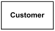

Класс без деталей

В этом разделе рассматриваются элементы, свойственные концептуальным (доменным) диаграммам классов, а также отдельные средства, полезные для технической диаграммы классов.

## Атрибуты и операции, видимость, свойства

Если брать более полную нотацию, класс разбивается на секции (compartments): имя класса, список атрибутов, список операций и при необходимости другие секции. Если атрибуты или операции не нужно показывать на текущем уровне детализации, соответствующую секцию можно скрыть. Отсутствие секции на диаграмме не доказывает, что у класса действительно нет таких элементов в модели.

У атрибутов и операций может быть проставлена видимость. Это самый частый способ использования видимости на диаграмме классов.


Класс с двумя атрибутами и одной операцией

И атрибуты, и операции являются признаками классификатора (features). Следующая схема показывает иерархию обобщений, связанную с признаками.

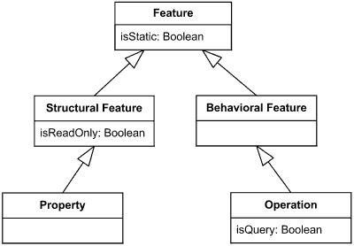

Иерархия признаков классификатора

Из этой иерархии видно, что и атрибуты, и операции могут иметь область действия на уровне экземпляра или классификатора. Если признак имеет область действия классификатора, он относится к самому классу, а не к каждому отдельному экземпляру.

Чтобы показать область действия на уровне классификатора, нужная часть подчёркивается.


Класс с указанной видимостью атрибутов и операций, а также статической операцией

### Атрибуты

**Атрибуты** показывают структурные свойства классификатора. В программной реализации им часто соответствуют поля, но в UML корректнее говорить именно об атрибутах или свойствах. В общем случае описание атрибута состоит из его имени, типа, кратности, начального значения и свойств.

UML имеет стандартные примитивные типы, например `Boolean`, `Integer`, `UnlimitedNatural`, `String` и `Real`. Типы, специфичные для языка программирования (`int`, `long`, `bool` и т.п.), лучше использовать только на технических диаграммах или в профиле конкретной реализации. Более сложные типы данных лучше расписать в виде отдельных классов или типов данных. Атрибуты могут быть доступны только на чтение, если у них установлено свойство `isReadOnly`.

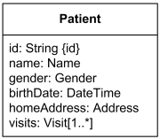

Класс с полями

Атрибуты и другие свойства могут иметь модификаторы, уточняющие их семантику:

| **Модификатор** | **Описание** |
| --- | --- |
| `id` | Свойство является частью идентификатора экземпляра класса, которому оно принадлежит. |
| `readOnly` | Свойство доступно только для чтения (`isReadOnly = true`). |
| `ordered` | Значения составного свойства упорядочены (`isOrdered = true`). |
| `unique` | Свойство с несколькими значениями не содержит дубликаты (`isUnique = true`). |
| `nonunique` | Свойство с несколькими значениями может содержать дубликаты (`isUnique = false`). |
| `sequence` или `seq` | Свойство является последовательностью (`isUnique = false`, `isOrdered = true`). |
| `redefines property-name` | Свойство переопределяет наследуемое свойство с указанным именем. |
| `subsets property-name` | Значения свойства должны быть подмножеством значений указанного свойства. |
| `union` | Свойство является объединением подмножеств, которые указаны через `subsets`. |
| `property-constraint` | Ограничение, накладываемое на свойство. |

Большая часть этих модификаторов особенно полезна при работе с концами ассоциаций.

Формальный синтаксис описания полей следующий:

```
видимость имя : тип [кратность] = начальное_значение {модификаторы}
```

Кратность задаёт, сколько значений может иметь атрибут или другой элемент с кратностью.

### Операции

**Операции** показывают поведение, которое классификатор предоставляет своим экземплярам или внешним потребителям. Операция задаёт сигнатуру: имя, параметры, возвращаемые значения и свойства. Метод в строгом смысле — это реализация операции некоторым поведением, поэтому на диаграмме классов обычно корректнее говорить об операциях.

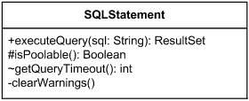

Класс с операциями

Полезное свойство операции, которое можно показывать на диаграммах: операция может только возвращать данные, не меняя состояние объекта. Такое свойство называется `isQuery`.

Формальный синтаксис описания операции следующий:

```
видимость имя (параметры) : тип {свойства}
```

При этом каждый параметр описывается так:

```
направление имя : тип = значение
```

Направление показывает, как параметр используется операцией. Направлений может быть несколько:

- `in` — параметр является входным, его значение используется операцией, но не меняется;
- `out` — параметр является выходным, это хранилище, куда операция помещает значение;
- `inout` — параметр является и входным, и выходным;
- `return` — значение, возвращаемое операцией.

В целом направление на диаграммах показывается не так уж часто, обычно подразумевается, что параметры операции являются входными. Если параметр одновременно передаётся в операцию и изменяется как результат выполнения, это параметр с направлением `inout`.

## Стандартные ключевые слова и стереотипы классов

В разделе имени, кроме самого имени, часто указывается ключевое слово или стереотип, уточняющий назначение класса. Важно различать элементы UML и расширения из стандартного профиля. Например, интерфейс и перечисление — это отдельные виды классификаторов, а `«utility»`, `«focus»` и `«auxiliary»` — стереотипы стандартного профиля.

- `«interface»` — интерфейс, задающий контракт без реализации;
- `«enumeration»` — перечисление;
- `«utility»` — класс-служба без экземпляров, содержащий статические атрибуты и операции;
- `«type»` — класс, задающий область объектов и операции без физической реализации;
- `«auxiliary»` — вспомогательный класс, содержит какую-то вторичную логику для работы основного класса;
- `«focus»` — основной класс, содержащий ключевую логику;
- `«metaclass»` — класс, экземплярами которого являются классы.

# Обобщения

Отношение обобщения позволяет показать, что один классификатор является более общим, а другой — его специализацией. Экземпляр специализации является также косвенным экземпляром общего классификатора. В объектно-ориентированном проектировании это близко к идее подстановки: объект подкласса можно рассматривать как объект суперкласса на соответствующем уровне абстракции.

Напомним, что в случае обобщений существует полезное свойство `{redefines}`, которое показывает, что мы переопределяем какую-то часть родительского класса в дочернем.


Пример иерархии наследования

В целом обобщения позволяют показать достаточно гибкую структуру наследования, которая ограничивается только тем, что цепочка обобщений не должна превратиться в цикл. При этом множественное наследование, несколько иерархий наследования и вот это всё разрешается и при необходимости даже приветствуется. С другой стороны, нотация никак не решает, например, проблему ромбовидного наследования, так что используйте это осторожно.

## Подмножества обобщений

В UML существует возможность выделять в множестве обобщений *подмножества обобщений* (generalization set) и задавать ограничения для них.

Рассмотрим пример для информационной системы отдела кадров. Допустим, что для экземпляров класса `Person` требуется смоделировать две независимые классификации: пол (`Gender`) и служебное положение (`Employment Status`). Подклассы `MalePerson` и `FemalePerson` могут входить в одно множество обобщений, а `Employer` и `Employee` — в другое. Для каждого множества можно отдельно указать имя и ограничения.

Имена множеств обобщений указываются рядом с обобщением после двоеточия. Если нужно охватить несколько обобщений, используется пунктирная линия, соединяющая соответствующие стрелки обобщения, и подпись множества. Помимо имени можно указать ограничения. Возможные варианты приведены в таблице.

| Ограничение | Применение |
| --- | --- |
| `{complete}` полнота | Множество обобщений является полным: каждый экземпляр общего классификатора должен быть экземпляром хотя бы одной специализации из этого множества. |
| `{incomplete}` неполнота | Множество обобщений не является полным: у общего классификатора могут быть экземпляры, которые не относятся ни к одной специализации из этого множества. |
| `{disjoint}` несовместность | Специализации не пересекаются: один экземпляр не может одновременно принадлежать нескольким специализациям из этого множества. |
| `{overlapping}` совместность | Специализации могут пересекаться: один экземпляр может одновременно принадлежать нескольким специализациям из этого множества. |

Пары `{complete}` / `{incomplete}` и `{disjoint}` / `{overlapping}` являются взаимоисключающими. Значения по умолчанию — `{incomplete, overlapping}`.

# Ассоциации

При работе с ассоциациями полезно помнить, что они описывают возможные связи между экземплярами классификаторов. Концы ассоциации в UML являются свойствами, поэтому у них могут быть имена ролей, кратности, навигация, ограничения и другие характеристики.

У ассоциации и её концов есть несколько важных обозначений:

- **имя ассоциации (возможно, вместе с направлением чтения);**
- **кратность конца ассоциации;**
- **агрегации или композиция (рисуется у контейнера);**
- **возможность навигации для конца ассоциации (можно ли пройти в заданном направлении);**
- **роль конца ассоциации (как он участвует);**
- видимость конца ассоциации;
- **упорядоченность объектов на конце ассоциации;**
- изменяемость множества объектов на конце ассоциации;
- **ограничения subset и union конца ассоциации;**
- **класс ассоциации;**
- квалификатор конца ассоциации;
- переопределение конца ассоциации.

## Агрегация и композиция

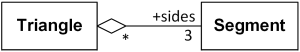

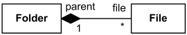

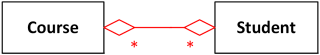

Shared aggregation в UML имеет слабую формальную семантику: спецификация намеренно оставляет точный смысл такой связи методике или предметной области. Композиция строже: часть в один момент времени принадлежит не более чем одному композиту, а удаление композита влечёт удаление его частей в рамках модели.

## Кратность ассоциации

Кратность указывается не у классификатора вообще, а у элементов, которые имеют кратность: например, у атрибутов, параметров и концов ассоциации.

<aside>
💡 **Кратность множества** — это множество чисел, которые задают все допустимые значения мощности для данного множества.

</aside>

Проще говоря, кратность показывает пределы, в которых может изменяться количество значений у свойства или на конце ассоциации. Кратность задаётся в формате `low .. high`, где в качестве границ могут быть неотрицательные целые числа и `*` в качестве верхней границы. Примеры выражений кратности:

| Выражение кратности | Множество может иметь… |
| --- | --- |
| `0..*` или `*` | Произвольное число элементов |
| `1..*` | Один или более элементов |
| `0..1` | Не более одного элемента |
| `1..10` | От одного до десяти элементов |
| `1..3, 5, 7..10` | Один, два, три, пять, семь, восемь, девять или десять элементов |
| `5..3` | Некорректная кратность. Нижняя граница больше верхней |
| `-1..3` | Некорректная кратность. Отрицательные числа недопустимы |

При этом на концах ассоциации могут быть указаны дополнительные опции:

| **Тип коллекции** | **`isOrdered`** | **`isUnique`** |
| --- | --- | --- |
| Мультимножество | `false` | `false` |
| Массив, список | `true` | `false` |
| Множество | `false` | `true` |
| Упорядоченное множество | `true` | `true` |

## Класс ассоциации

Класс ассоциации используется, когда у связи между классами есть собственные атрибуты, операции или бизнес-правила. Типичный пример — связь “студент записан на курс”. Если у записи есть дата, статус, оценка или причина отчисления, то это уже не просто линия между студентом и курсом, а отдельное предметное понятие.

Класс ассоциации особенно часто появляется там, где в будущей архитектуре данных возникла бы таблица связи с дополнительными полями. Но на концептуальной диаграмме мы всё равно описываем не таблицу, а смысловую связь предметной области.

## Навигация

Навигация показывает, в каком направлении один класс “знает” о другом в рамках модели. На концептуальном уровне навигацию стоит указывать только тогда, когда это действительно важно для понимания ответственности или ограничений. На техническом уровне навигация ближе к тому, какие ссылки или зависимости будут в коде.

Не нужно автоматически ставить стрелки на всех ассоциациях. Если направление неизвестно или неважно на текущем уровне абстракции, ассоциацию можно оставить ненаправленной.

# Бизнес-правила и ограничения на диаграмме классов

Бизнес-правила можно фиксировать на диаграмме классов несколькими способами:

- constraint в фигурных скобках рядом с атрибутом;
- constraint на ассоциации;
- constraint на классе;
- note с текстом правила;
- ограничение на подмножестве обобщений;
- кратность ассоциации, если правило выражается количеством объектов.

Например, правило “у заказа должен быть хотя бы один товар” может быть выражено кратностью `1..*` на связи с позициями заказа. Правило “оплаченный заказ нельзя редактировать” лучше зафиксировать как note или constraint, потому что одной кратности недостаточно.

Связь с диаграммой деятельности прямая: guards на activity diagram часто превращаются в constraints или правила переходов состояния. Если в процессе есть условие `[заказ оплачен]`, это состояние или признак должен быть отражён в информационной модели.

# Диаграмма классов и программная архитектура

Диаграмма классов позволяет показать не только концептуальную модель (т.е. информационную архитектуру), но и непосредственно реализацию в виде набора классов, интерфейсов, перечислений и пр., а также связей между ними. Для этого применяются как базовые средства нотации, так и дополнительные элементы UML.

## Шаблонные классы

Зачастую появляется необходимость применить механизм, позволяющий однотипно работать с различными типами данных. Это, например, шаблоны в C++ или дженерики в C# и Java. UML предоставляет нотацию для добавления такой информации в модель с помощью шаблонных классов.

**Шаблонный класс** позволяет указать параметры, которые должны быть связаны с конкретными элементами модели при создании связанного классификатора. В роли таких параметров чаще всего выступают типы, но механизм шаблонов в UML шире, чем дженерики в языках программирования.

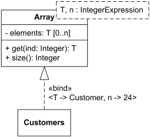

Пример шаблонного класса и связывания

В самом определении класса мы используем параметры шаблона, указанные в пунктирном прямоугольнике в углу классификатора. Чтобы показать, что создаётся связанный классификатор с конкретными значениями параметров, используется отношение `TemplateBinding`: пунктирная стрелка от связанного элемента к шаблону с ключевым словом `«bind»` и указанием подстановок. Всё это показано на примере выше.

Важная особенность: шаблонными могут быть не только классы, но и отдельные операции, если нужно параметризовать их сигнатуру.

## Вложенные классы

Вложенные классы в реализации встречаются не так часто, но отдельная нотация под них также есть: вложенность показывается с помощью линии с якорем на конце.

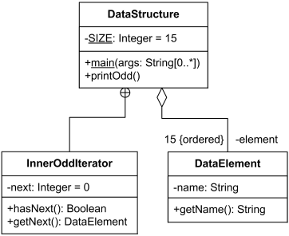

Пример вложенного класса

## Отношение зависимости

**Отношение зависимости** — достаточно общее отношение, которое показывает, что один элемент модели нуждается в другом для своего определения или реализации. Например, класс может зависеть от другого класса, если операция использует его как тип параметра. Напомним, что зависимость рисуется **от зависимого элемента к независимому**. Зависимости бывают разных типов и выстраиваются в иерархию:

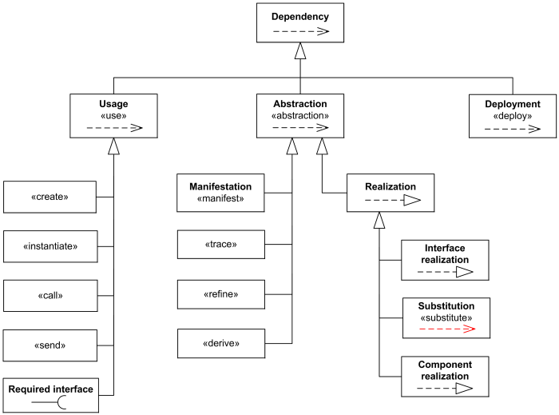

Иерархия типов отношений зависимости

Зависимости, как видно на диаграмме мета-модели, делятся на три категории:

- Отношение использования (`use`) показывает, что зависимый класс каким-то образом использует экземпляры независимого класса.
- Отношение абстракции (`abstraction`) показывает, что два класса показывают одно и то же, но на разных уровнях абстракции.
- Отношение развёртывания (`deploy`) показывает, что зависимый артефакт развёртывается на заданном узле.

## Отношение реализации и интерфейсы

Отдельно из иерархии зависимостей выделяется **отношение реализации**. В общем контексте оно показывает, что два элемента модели зависят таким образом, что один из них является спецификацией (т.е. контрактом), а другой — реализацией этой спецификации.


Обычно, когда мы говорим про интерфейсы, мы используем два типа отношений: реализацию, чтобы показать конкретную реализацию контракта, и зависимость использования (`Usage`), чтобы показать, что классификатору для работы нужен интерфейс. Стереотип `«call»` имеет более узкий смысл: он показывает вызов операции другой операцией. На технических диаграммах такие отношения помогают показать, что класс зависит от контракта, а не от конкретной реализации.

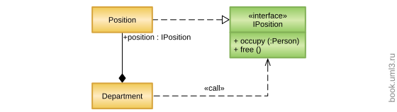

В UML 2 такую комбинацию отношений можно показать с помощью lollipop-нотации, также известной как ball-and-socket. В этом случае предоставляемый интерфейс показывается кружком, а требуемый интерфейс — полукругом. Соединение кружка и полукруга показывает совместимость предоставляемого и требуемого интерфейсов.


