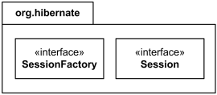
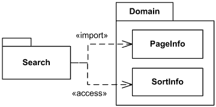

:::note[TL;DR]
Этот раздел описывает диаграмму пакетов. Она используется для группировки элементов модели и показа зависимостей между крупными частями системы, слоями или пространствами имён.
:::

# Диаграмма пакетов

Ещё одна диаграмма, призванная упорядочить модель в целом и диаграмму классов частности — диаграмма пакетов.

:::tip[Определение]
С точки зрения синтаксиса **пакет** изображается в виде прямоугольника с ярлычком.

С точки зрения семантики **пакет** — это группирующая сущность, задающая пространство имён и объединяющая набор элементов, которые связаны друг с другом логически.
:::

Пример пакета с двумя элементами

Не все элементы могут быть частью пакета, но все классификаторы заведомо могут быть частью пакета. Обычно на уровне интуиции не возникает желания вложить в пакет что-то некорректное с точки зрения семантики (например, действие), поэтому этот момент обычно не проговаривают, но имеют в виду.

Пакет, как и класс, также может быть шаблонным, и тогда нам нужно связать с ним другой пакет.

Для простоты восприятия пакет действительно можно представить как пространство имён в том же C# или Java. Это же позволяет нам очевидным образом реорганизовать диаграмму классов в диаграмму пакетов, если код уже готов.

## Отношение импорта и слияния

Пакеты могут взаимодействовать как с другими пакетами, так и с их элементами. Для этого используется **отношение импорта**, которое похоже на зависимость со стереотипом `import` или `access`, но семантически является отдельным направленным отношением.

Публичный и приватный импорт элементов

Выбор ключевого слова зависит от того, импортируется ли элемент или пакет публично или приватно. Импорт является публичным, если импортируемые в пакет элементы становятся доступными извне через этот пакет, иначе он считается приватным. Для первого случая используется ключевое слово `import`, для второго `access`. Если ключевое слово опущено, то обычно подразумевается публичный импорт.

Второе отношение, используемое на диаграмме пакетов — это **отношение слияния**. Семантически оно похоже на отношение обобщения, но в данном случае содержание сливаемых пакетов буквально становится содержимым пакета, который с ними связан. Синтаксически отношение слияния выглядит как отношение зависимости со стереотипом `merge`.

Слияние пакетов `Kernel` и `Profiles` в пакет `Constructs`

## В модели

Пакеты полезны после определения [программной архитектуры и слоёв](/modelling/software-architecture-and-layers), когда нужно сделать зависимости крупных частей видимыми. Логические модули и контракты раскрываются на [диаграмме компонентов](/reference/component-diagrams), а не внутри одной большой диаграммы классов.
