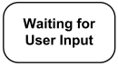
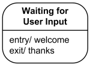
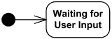
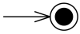
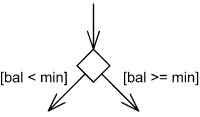
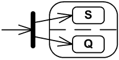
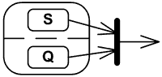
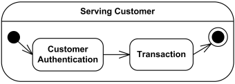
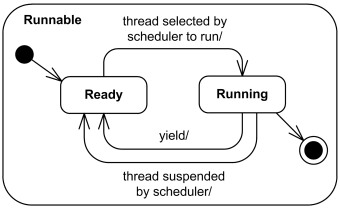
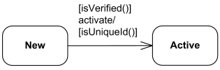

:::note[TL;DR]
Этот раздел описывает диаграмму состояний. Она используется, когда важно показать жизненный цикл объекта, допустимые переходы между состояниями и условия этих переходов.
:::

# Диаграмма состояний

Диаграмма состояний, или диаграмма автомата (state machine diagram), показывает поведение части рассматриваемой системы через состояния и переходы между ними. Она полезна, когда у объекта или другого классификатора есть значимый жизненный цикл, а допустимость операций зависит от текущего состояния.

В общем и целом диаграмма состояний довольно простая: основной элемент на ней — состояние с переходами между этими состояниями. С этой точки зрения диаграмма состояний похожа на диаграмму деятельности, но описывает другой аспект поведения.

## Базовая нотация

Состояния на диаграмме могут быть трёх типов, и самый базовый тип — простое состояние (оно так и называется). **Простое состояние** — это прямоугольник со скруглёнными краями. Что может содержать в себе простое состояние:

- **Название**. Как ни странно, оно является опциональным, и при этом все состояния без названий являются различными состояниями.
- **Внутреннюю деятельность**. С помощью этого элемента нотации можно показать поведение, связанное с состоянием: `entry` выполняется при входе в состояние, `do` выполняется пока объект находится в состоянии, `exit` выполняется при выходе из состояния. Это не условия, а виды поведения состояния.
- **Внутренние переходы**. По смыслу они схожи с описанием внутренней деятельности, но позволяют указывать свои условия и события срабатывания эффектов.



Состояние без конкретики



Состояние с действиями при входе в него и выходе из него

Эти состояния могут соединяться **переходами**, которые в самом простом случае выглядят как направленная стрелка без надписей. В этом смысле переходы между состояниями аналогичны переходам между действиями на диаграмме деятельности.

В UML также выделяются **псевдосостояния**, которые не показывают непосредственно состояние, но позволяют смоделировать более сложное поведение, чем просто переход из одного состояния в другое.

**Начальное псевдосостояние** показывает начальную вершину региона автомата. Для диаграммы, которая описывает исполняемый жизненный цикл, его обычно стоит показывать явно, чтобы было понятно, с какого состояния начинается поведение.



Начальное псевдосостояние

**Конечное состояние** показывает завершение региона автомата. Если диаграмма описывает весь жизненный цикл объекта, это можно трактовать как завершение жизненного цикла; если показан только фрагмент поведения, завершается только рассматриваемая часть.



**Choice** позволяет выбрать дальнейший переход по guard-условиям.



**Fork** и **join** позволяют показать параллельные ветви поведения, если объект действительно проходит параллельные активности.





Переход на диаграмме состояний обычно описывается в формате:

```text
trigger [guard] / effect
```

где trigger — событие или вызов, guard — условие перехода, effect — действие при переходе.

## Дополнительная нотация

Кроме простых состояний есть составные состояния. Они помогают скрыть внутреннюю детализацию и показать, что несколько вложенных состояний относятся к одному крупному этапу жизненного цикла.



Составные состояния могут быть простыми или ортогональными. Ортогональные регионы используются, когда объект одновременно находится в нескольких независимых поджизненных циклах. Использовать их стоит осторожно: если параллельность не важна для предметной области, диаграмма станет сложнее без пользы.

Поверхностная и глубокая история позволяют вернуться в ранее активное вложенное состояние. В учебных моделях это редко нужно, но полезно знать, что такая нотация существует для сложных жизненных циклов.

Виды триггеров: вызов операции, сигнал, любое принимаемое событие, событие времени, событие изменения. Guards на переходах должны согласовываться с бизнес-правилами и атрибутами концептуального класса.

## Протоколы на диаграмме состояний

Протокол как средство описания жизненного цикла классификатора для внешних потребителей



Без истории, без действий в состояниях


Переходы описывают предусловие, триггер и постусловие



Протокольная диаграмма состояний описывает допустимые операции классификатора с точки зрения внешнего потребителя. Она отвечает не на вопрос “что происходит внутри UI”, а на вопрос “какие операции допустимы над объектом в данном состоянии”.

Диаграмма состояний описывает поведение классификатора через состояния и переходы. Объект находится в состоянии, событие может вызвать переход, guard определяет, разрешён ли этот переход, effect выполняется при переходе. Поведения `entry`, `do` и `exit` относятся к состоянию, а не к переходу. State machine обрабатывает события по модели run-to-completion: событие обрабатывается, автомат приходит в устойчивую конфигурацию, затем обрабатывается следующее событие.

Поэтому state diagram лучше строить для объектов с настоящим жизненным циклом: заказ, заявка, документ, платёж, инцидент. Если на диаграмме состояний появляются “открыта форма”, “нажата кнопка”, “пользователь смотрит экран”, модель часто уходит в UI-состояния вместо жизненного цикла предметного объекта.

## В модели

Состояния и переходы опираются на [бизнес-правила и ограничения](/modelling/business-rules-and-constraints) и сценарии, где эти изменения существенны. Последовательность событий можно проверить на [диаграмме последовательности](/reference/sequence-diagrams), а временные ограничения — на [диаграмме синхронизации](/reference/timing-diagrams).
