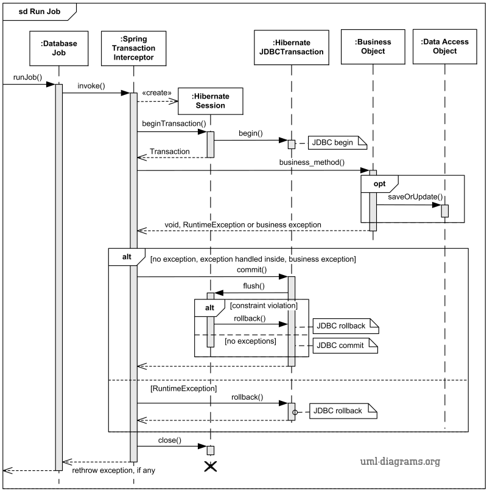

:::note[TL;DR]
Этот раздел описывает диаграмму последовательности. Она показывает взаимодействие участников во времени и помогает проверить, что сценарий реализуется существующими объектами, компонентами и операциями.
:::

# Диаграмма последовательности

**Диаграмма последовательности** (sequence diagram) — это разновидность диаграммы взаимодействия (interaction diagram). Она показывает, какие участники взаимодействия обмениваются сообщениями и в каком порядке происходят события этого взаимодействия.

Главный вопрос диаграммы последовательности: кто кому отправляет сообщение, когда это происходит и что должно существовать в модели, чтобы такой обмен был возможен.

Диаграмма последовательности близка к диаграмме деятельности, но отвечает на другой вопрос. Диаграмма деятельности показывает процесс как поток действий, решений и объектов. Диаграмма последовательности показывает реализацию сценария через взаимодействие конкретных участников: актора, объектов, компонентов, сервисов, репозиториев, шлюзов или других линий жизни.


Общий вид диаграммы последовательности

# Взаимодействие и трасса

**Взаимодействие** (interaction) — это поведение, которое описывает обмен сообщениями между участниками. Оно задаёт допустимые и, при необходимости, недопустимые трассы выполнения.

**Трасса** (trace) — это последовательность событий, возникающих при выполнении взаимодействия. В UML это не обязательно простой линейный список: события на разных линиях жизни частично упорядочены. Отправка сообщения всегда происходит раньше его получения, а события на одной линии жизни читаются сверху вниз.

Важно: вертикальная ось на обычной диаграмме последовательности показывает порядок, но не измеряет длительность. Расстояние между двумя сообщениями не означает “прошло больше времени”. Если нужно моделировать реальные временные ограничения, используют временные ограничения (time constraints), ограничения длительности (duration constraints) или диаграмму синхронизации (timing diagram).

# Линия жизни

**Линия жизни** (lifeline) представляет участника взаимодействия. Участником может быть:

- актор (actor);
- объект или экземпляр класса;
- часть компонента;
- сам компонент;
- внешний сервис;
- база данных или другое хранилище, если оно важно на выбранном уровне детализации.

Обычно линия жизни подписывается в формате:

```text
имяЭкземпляра : Тип
```

Примеры:

```text
customer : Customer
orderService : OrderService
paymentGateway : PaymentGateway
```

Если имя экземпляра не важно, можно оставить только тип:

```text
: OrderRepository
```

Если тип не важен, можно оставить только имя роли. Но для технической диаграммы последовательности лучше указывать типы, чтобы потом проверить связь с диаграммой классов или компонентов.

# Сообщения

**Сообщение** (message) показывает коммуникацию между линиями жизни. В UML сообщение связывает событие отправки и событие получения. На диаграмме сообщение обычно выглядит как стрелка от отправителя к получателю.

Основные виды сообщений:

| Сообщение | Смысл |
| --- | --- |
| Синхронный вызов (synchronous call) | Отправитель вызывает операцию и ждёт завершения обработки. |
| Асинхронный вызов (asynchronous call) | Отправитель передаёт сообщение и не блокируется ожиданием результата. |
| Асинхронная отправка сигнала (asynchronous signal) | Отправитель посылает сигнал как отдельный объект коммуникации. |
| Ответное сообщение (reply message) | Получатель возвращает результат или управление отправителю. |
| Сообщение создания (create message) | В результате сообщения появляется новая линия жизни. |
| Сообщение уничтожения (delete message) | В результате сообщения линия жизни завершается. |
| Самовызов (self-message) | Линия жизни отправляет сообщение самой себе. |
| Найденное сообщение (found message) | Получатель известен, но отправитель находится вне рассматриваемого взаимодействия. |
| Потерянное сообщение (lost message) | Отправитель известен, но получатель находится вне рассматриваемого взаимодействия. |

Если сообщение выглядит как вызов операции, эта операция должна быть описана у получателя или хотя бы явно обоснована проектным решением. Например, сообщение `createOrder(data)` к `orderService : OrderService` предполагает, что у `OrderService` есть соответствующая операция или ответственность.

# Активация

**Активация**, или спецификация выполнения (execution specification), показывает период, в течение которого линия жизни выполняет поведение. На диаграмме она обычно изображается узким прямоугольником на линии жизни.

Активация полезна, когда нужно показать вложенность вызовов. Например, сервис обрабатывает запрос, внутри этого обработки вызывает репозиторий, затем шлюз уведомлений и только после этого возвращает результат.

Не стоит ставить активации механически на каждое сообщение. Они помогают читать диаграмму, если показывают реальное выполнение поведения или вложенность вызовов.

# Создание и уничтожение

Если объект создаётся внутри сценария, его линия жизни может начинаться не сверху диаграммы, а с сообщения создания. Такое сообщение обычно направлено на заголовок новой линии жизни.

Если объект прекращает существование внутри взаимодействия, конец линии жизни отмечается уничтожением (destruction occurrence), часто в виде крестика. Это имеет смысл показывать для временных объектов, сессий, транзакций, подключений или других сущностей, чей жизненный цикл важен в сценарии.

Для большинства предметных объектов уничтожение на sequence diagram показывать не нужно, если оно не является частью сценария.

# Комбинированные фрагменты

**Комбинированный фрагмент** (combined fragment) позволяет показать условия, альтернативы, циклы, параллельность и другие конструкции внутри взаимодействия. Фрагмент изображается рамкой с оператором взаимодействия (interaction operator) в левом верхнем углу.

Основные операторы:

| Оператор | Название | Когда использовать |
| --- | --- | --- |
| `alt` | альтернатива (alternative) | Когда возможна одна из нескольких ветвей. Каждая ветвь имеет guard. |
| `opt` | опция (option) | Когда фрагмент выполняется только при выполнении условия. Это частный случай `alt` с одной веткой. |
| `loop` | цикл (loop) | Когда фрагмент повторяется, пока выполняется условие или пока не исчерпан диапазон повторений. |
| `par` | параллельность (parallel) | Когда несколько операндов могут выполняться параллельно. |
| `break` | прерывание (break) | Когда при выполнении условия фрагмент заменяет оставшуюся часть охватывающего взаимодействия. |
| `critical` | критическая область (critical region) | Когда фрагмент должен выполняться атомарно относительно параллельных фрагментов. |
| `assert` | утверждение (assertion) | Когда показанная трасса является единственно допустимой в данном фрагменте. |
| `neg` | отрицательная трасса (negative) | Когда фрагмент показывает недопустимое взаимодействие. |

В учебной модели основной упор обычно стоит делать на `alt`, `opt`, `loop` и `par`. Остальные операторы полезны, но легко перегружают диаграмму, если нет явной причины их использовать.

Guard-условия внутри combined fragments должны быть связаны со сценарием, требованиями или бизнес-правилами. Если на диаграмме есть ветка `[оплата отклонена]`, такое состояние или результат должен быть понятен из сценария и информационной модели.

# Гейты и ссылки на взаимодействия

**Гейт** (gate) — это точка входа или выхода сообщения на границе взаимодействия или фрагмента. Гейты нужны, когда взаимодействие описано не полностью внутри одной рамки или когда фрагмент переиспользуется.

**Ссылка на взаимодействие** (interaction use) позволяет сослаться на другое уже описанное взаимодействие. На диаграмме она часто показывается прямоугольником с ключевым словом `ref`. Это удобно, когда один сценарий становится слишком большим и часть обмена сообщениями лучше вынести в отдельную диаграмму последовательности.

Пример:

```text
ref Проверить оплату
ref Отправить уведомление
```

# Инварианты состояния

**Инвариант состояния** (state invariant) показывает условие, которое должно быть истинно для линии жизни в определённой точке взаимодействия. Например, для заказа можно указать:

```text
{status = Paid}
```

Такой инвариант полезен, если sequence diagram должна быть согласована с диаграммой состояний. Если после сообщения `confirmPayment()` заказ должен перейти в состояние `Оплачен`, это можно явно показать инвариантом состояния или связать с переходом на state machine diagram.

# Связь с другими диаграммами

Диаграмма последовательности не должна появляться изолированно. Обычно она строится по уже выбранному сценарию:

1. Сценарий берётся из спецификации варианта использования или диаграммы деятельности.
2. Участники взаимодействия берутся из технической диаграммы классов, диаграммы компонентов или внешнего контекста системы.
3. Сообщения согласуются с операциями, ответственностями или интерфейсами получателей.
4. Возвращаемые данные должны соответствовать типам, DTO, объектам или результатам, которые есть в модели.
5. Состояния объектов не должны противоречить диаграмме состояний.

Если sequence diagram показывает вызов `cancelOrder()`, но на диаграмме классов нет класса, который отвечает за отмену заказа, это сигнал к уточнению технической модели. Если после `cancelOrder()` заказ остаётся в состоянии `Delivered`, это сигнал к проверке state diagram и бизнес-правил.

# Типичные ошибки

Частые ошибки при построении диаграммы последовательности:

- показывать классы вместо экземпляров или ролей, не используя формат `объект : Класс`;
- отправлять сообщения объектам, которых нет в технической модели;
- называть сообщения произвольными фразами вместо операций или осмысленных событий;
- использовать sequence diagram как блок-схему процесса без линий жизни и сообщений;
- показывать UI-клики вместо проектного взаимодействия объектов и компонентов;
- считать расстояние между сообщениями реальным временем;
- перегружать одну диаграмму всеми альтернативами большого сценария;
- использовать `alt` и `loop`, не связывая условия со сценарием и бизнес-правилами;
- забывать про возвращаемые значения там, где они важны для дальнейшего поведения;
- показывать вызовы базы данных или внешнего сервиса на слишком низком уровне детализации без необходимости.

# Пример технического уровня

На технической диаграмме последовательности обычно видны классы и компоненты реализации: контроллер, сервис приложения, репозиторий, шлюз внешней системы, объект модели, DTO. Такая диаграмма не заменяет код, но помогает проверить, хватает ли выбранной структуры классов и компонентов для реализации сценария.



Пример технической диаграммы последовательности

## В модели

Диаграмма уточняет [сценарии и потоки](/modelling/scenarios-and-flows) и техническое взаимодействие из [участников и потоков процесса](/modelling/process-participants-and-flows). Тот же сценарий можно показать с акцентом на связи на [диаграмме коммуникации](/reference/communication-diagrams), на время — на [диаграмме синхронизации](/reference/timing-diagrams), а на крупные фрагменты — на [обзорной диаграмме взаимодействия](/reference/interaction-overview-diagrams).
