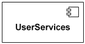
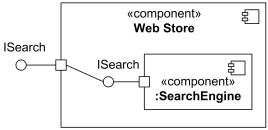
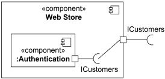

:::note[TL;DR]
Этот раздел описывает диаграмму компонентов. Она показывает крупные программные части системы, их интерфейсы и зависимости, не раскрывая внутреннюю реализацию каждого компонента.
:::

# Диаграмма компонентов

Когда система достаточно большая, показывать все классы на одной диаграмме становится неудобно. В этом случае полезно подняться на уровень выше и показать крупные программные части системы, их интерфейсы и зависимости. Для этого в UML используется диаграмма компонентов.

## Компоненты

Дадим понятие компонента.

<aside>
💡

С точки зрения синтаксиса **компонент** — это прямоугольник, в углу которого показана специальная иконка.

С точки зрения семантики **компонент** — это структурированный классификатор, обладающий поведением.

</aside>

Компонент без иконки

Компонент с иконкой

**Структурированный классификатор** позволяет показать, какие внутренние части есть у классификатора и как они взаимодействуют друг с другом и с внешним миром через порты, интерфейсы и соединители. Когда на диаграмме показываются части компонента, речь идёт не о произвольных прямоугольниках, а о свойствах компонента и их экземплярах во время выполнения.

С точки зрения прагматики **компонент** выделяет какую-то часть системы, скрывая детали реализации, предоставляя во внешний мир набор интерфейсов и запрашивая другие интерфейсы. Компоненты как раз позволяют выделять крупные и, что немаловажно, заменяемые модули системы. Возможность замены определяется тем, что для работы модуля нужны только интерфейсы.

Компоненты могут определяться как сами по себе, и тогда это будет просто верхнеуровневая диаграмма, так и с внутренней структурой (например, вложенными компонентами или классами), и тогда это будет более приближенная к реализации диаграмма.

Компонент не обязан соответствовать одному классу или одному пакету. Чаще компонент группирует набор классов и пакетов, которые вместе реализуют заметную часть системы: клиентское приложение, backend API, модуль уведомлений, модуль оплаты, подсистему отчётов, адаптер внешней системы.

## Соединители и порты

Как следует из понятия компонента, он может содержать в себе другие классификаторы, взаимодействующие между собой и с внешним миром. При этом сам компонент также может взаимодействовать с внешним миром, т.е. содержимое компонента не обязано описывать его самого полностью.

Чтобы показать точку взаимодействия с компонентом, используются **порты**. Порт показывается с помощью квадратика на границе компонента и является его частью. Порт может требовать и предоставлять несколько интерфейсов. С точки зрения классификатора порт является его свойством (т.е. полем).

Порт с интерфейсами

Чтобы показать взаимодействие между портами компонента или другого структурированного классификатора, используются соединители. **Соединитель** — это связь между частями, портами или частью и портом внутри структурированного классификатора. Соединители бывают двух типов:

- **Сборочный соединитель** соединяет два порта, показывая их взаимодействие. Частный случай сборочного соединителя — порт одного компонента предоставляет интерфейс, а порт другого компонента его запрашивает.

Сборочный соединитель

- **Делегирующий соединитель** связывает порт с одной из частей классификатора, если он запрашивает интерфейс или предоставляет его.

Делегирующие соединитель, предоставляющий интерфейс

Делегирующий соединитель, запрашивающий интерфейс
