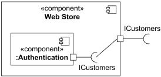

:::note[TL;DR]
Этот раздел описывает диаграмму внутренней структуры. Она показывает внутренние части структурированного классификатора, его порты и соединители, когда важно раскрыть устройство элемента изнутри.
:::

# Диаграмма внутренней структуры

**Диаграмма внутренней структуры** (internal structure diagram) — это структурная диаграмма UML. Она показывает внутреннее устройство структурированного классификатора (structured classifier): какие части входят в него, как они связаны между собой и через какие точки классификатор взаимодействует с внешним миром.

В учебных моделях эта диаграмма используется редко, потому что похожие задачи часто решаются диаграммой компонентов или диаграммой классов. Но она важна для понимания портов, соединителей и внутренней структуры сложных элементов.

Типичный вопрос этой диаграммы: из каких внутренних частей состоит классификатор и как эти части взаимодействуют между собой?

# Структурированный классификатор

**Структурированный классификатор** (structured classifier) — это классификатор, который может иметь внутреннюю структуру. Такой классификатор может содержать части (parts), порты (ports) и соединители (connectors).

Примеры структурированных классификаторов:

- компонент (component);
- класс (class), если важно раскрыть его внутренние части;
- подсистема или модуль;
- устройство, состоящее из нескольких внутренних элементов;
- программный сервис, имеющий внутренние адаптеры, шлюзы и обработчики.

Важно: диаграмма внутренней структуры не показывает произвольную декомпозицию “для красоты”. Она должна описывать реальные структурные роли внутри классификатора.

# Части

**Часть** (part) — это свойство классификатора, которое представляет один из его внутренних элементов. В отличие от обычной ассоциации между классами, часть показывает роль элемента внутри конкретного структурированного классификатора.

Например, компонент `OrderService` может иметь внутренние части:

```text
validator: OrderValidator
repository: OrderRepository
notifier: NotificationGateway
```

Такая запись показывает не просто существование классов `OrderValidator`, `OrderRepository` и `NotificationGateway`, а их роли внутри конкретного классификатора.

# Порты

**Порт** (port) — это точка взаимодействия классификатора с внешним миром или с внутренними частями. Порт показывается небольшим квадратом на границе классификатора или внутри него.

Порт может предоставлять интерфейсы (provided interfaces) и требовать интерфейсы (required interfaces). Через порт удобно показать, что внешний мир взаимодействует не со всеми внутренностями элемента сразу, а с ограниченной точкой доступа.


Порт с интерфейсами

С точки зрения модели порт является свойством (property) классификатора. Это не просто декоративная точка на границе прямоугольника.

# Соединители

**Соединитель** (connector) показывает связь между частями, портами или частью и портом внутри структурированного классификатора. Соединитель описывает, как экземпляры внутренних частей могут взаимодействовать во время выполнения.

Соединители бывают двух важных видов:

- сборочный соединитель (assembly connector);
- делегирующий соединитель (delegation connector).

**Сборочный соединитель** (assembly connector) связывает части или порты, которые взаимодействуют друг с другом внутри классификатора. Частный случай: один порт предоставляет интерфейс, а другой этот интерфейс требует.


Сборочный соединитель

**Делегирующий соединитель** (delegation connector) связывает внешний порт классификатора с внутренней частью или внутренним портом. Он показывает, что запрос, пришедший на внешний порт, фактически передаётся внутрь.


Делегирующие соединитель, предоставляющий интерфейс



Делегирующий соединитель, запрашивающий интерфейс

# Когда использовать

Диаграмма внутренней структуры полезна, когда внешний вид элемента скрывает важную внутреннюю организацию.

Хорошие случаи использования:

- нужно раскрыть внутреннее устройство сложного компонента;
- нужно показать, какие внутренние части реализуют внешний интерфейс;
- нужно объяснить делегирование запросов через порт;
- нужно показать связи между частями внутри одного классификатора;
- нужно отделить внешний контракт элемента от его внутренней структуры.

Если нужно просто показать крупные модули системы и их интерфейсы, чаще достаточно диаграммы компонентов. Если нужно показать классы и связи предметной области, лучше использовать диаграмму классов.

# Связь с другими диаграммами

Диаграмма внутренней структуры тесно связана с диаграммой компонентов: компоненты могут иметь порты и внутренние части. Она также связана с диаграммой классов, потому что части и порты являются свойствами классификатора.

С диаграммой развёртывания связь косвенная. Диаграмма внутренней структуры показывает устройство классификатора, а диаграмма развёртывания показывает размещение артефактов на узлах. Не стоит смешивать эти уровни.

# Типичные ошибки

Частые ошибки при построении диаграммы внутренней структуры:

- использовать её как обычную диаграмму компонентов без внутренней структуры;
- рисовать части как независимые классы, не показывая их роль внутри классификатора;
- считать порт просто графической точкой, а не свойством модели;
- путать сборочный и делегирующий соединитель;
- показывать физическое размещение узлов вместо внутренней структуры классификатора;
- раскрывать слишком много деталей, которые лучше оставить на диаграмме классов или компонентов.

## В модели

К внутренней структуре переходят после определения [программной архитектуры и слоёв](/modelling/software-architecture-and-layers), когда внешнего контракта компонента уже недостаточно. Внешние интерфейсы и зависимости показаны на [диаграмме компонентов](/reference/component-diagrams), а физическое окружение — на [диаграмме развёртывания](/reference/deployment-diagrams).
