:::note[TL;DR]
Этот раздел описывает диаграмму развёртывания. Она связывает программные артефакты с узлами выполнения и помогает показать, где и в какой среде размещаются части системы.
:::

# Диаграмма развёртывания

Для описания системной архитектуры в UML используется специальная диаграмма развёртывания (или размещения). Она показывает узлы, среды выполнения, артефакты и связи между ними.

Сама по себе **диаграмма развёртывания** — это структурная диаграмма, которая показывает, каким образом артефакты размещаются на целевых узлах развёртывания. Компоненты могут быть связаны с этими артефактами через отношение `«manifest»`, но физически на узлах размещаются именно артефакты.

## Узлы и подключения

:::tip[Определение]
**Узел** с точки зрения UML — это вычислительный ресурс, на котором размещаются артефакты. Узел показывается в виде параллелепипеда. Формально узел является классификатором и одновременно целью развёртывания (`DeploymentTarget`).
:::

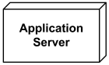

Просто узел

Узлы можно вкладывать как друг в друга, как с помощью композиции, так и визуально, непосредственно один внутрь другого.

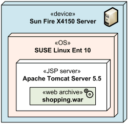

Вложенность узлов

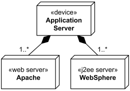

Вложенность узлов с помощью композиции

Узлы часто уточняются ключевыми словами `«device»` или `«executionEnvironment»`. Они показывают, что перед нами физическое устройство или среда выполнения. Многие инструменты дают этим обозначениям интерфейс стереотипов, но при чтении диаграммы важен смысл: это специализации узла.

**Устройство** (device) — это физический вычислительный ресурс. При необходимости его можно уточнять дополнительными стереотипами или просто именем узла, например:

- «application server»;
- «client workstation»;
- «mobile device»;
- «embedded device».

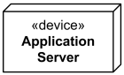

Пример устройства

**Среда выполнения** (execution environment) — это программная среда, внутри которой выполняются или размещаются другие элементы: операционная система, контейнер приложений, СУБД, браузер, виртуальная машина. Её также можно уточнять именем или стереотипом, например:

- «OS»;
- «workflow engine»;
- «database system»;
- «J2EE container»;
- «web server»;
- «web browser».

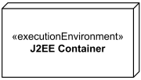

Пример среды выполнения

Узлы могут быть связаны друг с другом с помощью специального типа ассоциаций, **подключений** (communication path). На диаграмме развёртывания они показывают, какие узлы связаны и какие протоколы взаимодействия используются. Как и на обычных ассоциациях, можно указывать кратность, чтоб показать наличие нескольких экземпляров узлов, это полезно, например, в случаях, когда у нас есть балансировщик нагрузки и за ним несколько серверов.

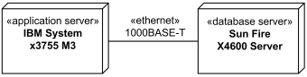

Физическое соединение между устройствами

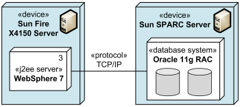

Соединение между средами выполнения

Важный момент, на который хочется обратить внимание: не забывайте про модель OSI, когда указываете протоколы взаимодействия между узлами. Некорректно показывать, например, что два устройства подключаются по HTTP, а браузер и веб-сервер — по TCP/IP. В первом случае идеально было бы показать физическое подключение по Ethernet или Wi-Fi, а во втором — по HTTPS.

Выбор протокола должен соответствовать уровню детализации модели. Между браузером и веб-сервером уместен HTTPS. Между приложением и PostgreSQL можно указать PostgreSQL protocol, а при более низком уровне детализации — TCP. Между физическими устройствами лучше показывать физическую или сетевую среду связи, если именно она важна для модели.

## Артефакты и их развёртывание

:::tip[Определение]
**Артефакт** — это классификатор, который показывает файл, документ или другой объект, который используется или создаётся в процессе разработки программы или появляется в ходе её установки и использования.
:::

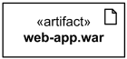

Простой артефакт

Артефакт показывается в виде прямоугольника с иконкой в углу и ключевым словом `«artifact»`.

Артефакты могут иметь дополнительные стереотипы:

| Стереотип | Смысл |
| --- | --- |
| `«file»` | Физический файл в контексте разрабатываемой системы. |
| `«document»` | Документ, не являющийся исходным или исполняемым файлом. |
| `«source»` | Исходный файл, который может быть скомпилирован или обработан. |
| `«library»` | Статическая или динамическая библиотека. |
| `«executable»` | Исполняемый файл программы. |
| `«script»` | Скрипт, который интерпретируется средой выполнения. |

Поскольку артефакт — это классификатор, то они могут быть связаны отношением ассоциации и производными, например, композицией. Также можно делать артефакты зависимыми друг от друга.

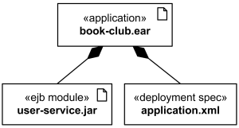

Артефакт с двумя вложенными артефактами

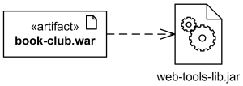

Зависимость артефакта

Основное назначение артефактов — **материализация** (манифестация) других элементов модели, например, компонентов. Другими словами, артефакт является физической единицей, которая реализует или представляет логический элемент модели. Развёртывание — это уже отдельное отношение, которое показывает размещение артефакта на цели развёртывания.

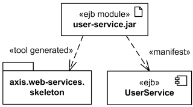

Пример отношения материализации

**Отношение материализации** — это отношение зависимости (если быть более точным, это подтип отношения абстракции, более близкий к реализации), которое показывается так же, как и сама зависимость, но подписывается ключевым словом `«manifest»`.

В UML 2 с помощью отношения материализации можно связывать не только непосредственно компоненты, но и другие элементы модели, которые могут быть представлены артефактом. Например, артефакт может материализовать компонент, класс или пакет. Это всё ещё не означает размещение на узле: размещение показывается отношением deployment.

Как показать, что артефакт развёртывается на каком-то узле? Есть два способа. Первый и самый часто употребимый: показать артефакт внутри нужного узла. Второй способ — связать артефакт и узел отношением зависимости с ключевым словом `«deploy»`.

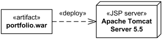

Пример развёртывания с помощью отношения

Также можно показать параметры развёртывания того или иного артефакта (например, конфигурационные файлы), это делается с помощью **спецификации развёртывания** (deployment specification). Она является подтипом артефакта с ключевым словом `«deployment spec»`.

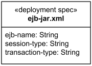

Спецификация развёртывания с тремя параметрами

В нотации спецификацию развёртывания обычно прикрепляют к развёрнутому компоненту или артефакту обычной dependency-стрелкой. Семантически такая спецификация параметризует deployment, а не является произвольной ассоциацией между двумя файлами.

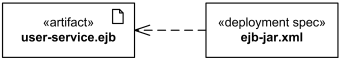

Пример с зависимостью

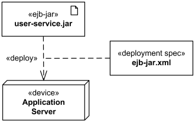

Пример с ассоциацией

## В модели

Диаграмма завершает переход к [системной архитектуре и развёртыванию](/modelling/system-architecture-and-deployment) и связывает его с [архитектурой данных](/modelling/data-architecture). Логические компоненты берутся из [программной архитектуры](/modelling/software-architecture-and-layers) и уточняются на [диаграмме компонентов](/reference/component-diagrams); внутренности отдельного компонента относятся к [диаграмме внутренней структуры](/reference/internal-structure-diagrams).
