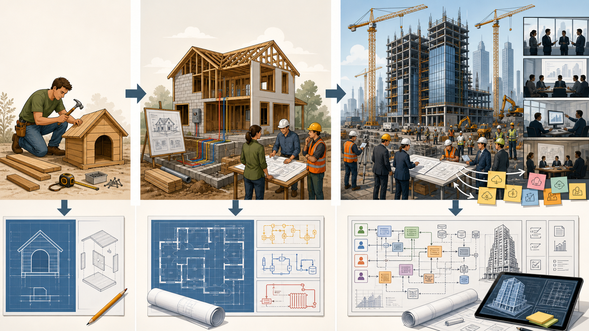

:::note[TL;DR]
Эта заметка объясняет, зачем моделирование нужно в целом, само по себе. Небольшой пример показывает, как рост сложности превращает предварительное согласование решений из необязательной подготовки в условие нормальной работы.
:::

В рамках большинства курсов, так или иначе связанных с чем-то, предшествующим разработке, первый вопрос обычно такой: зачем заниматься чем-то до написания кода, когда можно просто писать код и решать проблемы по мере необходимости? Для ответа удобно взять более капитальный (можно сказать, фундаментальный) пример, который достаточно близок к тому, что происходит при разработке ПО.

<figure style="text-align: center">

<figcaption style="margin-top: 0; font-style: italic">Иллюстрация примера ниже</figcaption>

</figure>

Допустим, вы хотите построить конуру для своей собаки. Задача простая и без подвохов. Для её выполнения не нужно каких-то особых знаний, кроме того, что такое конура, как она должна выглядеть и какого быть размера. С материалами всё тоже просто и понятно: доски (в идеале ровные), гвозди, молоток, рулетка, несколько часов/дней работы, и всё готово.

Следующий уровень сложности — построить дом для семьи. Это уже более сложная задача, так как одного визуального представления в голове не хватит, чтобы понять, что в итоге должно получиться. Перед началом строительства крайне хочется сделать несколько эскизов и чертежей, на которых будет зафиксирована планировка дома и разводка коммуникаций (освещение, отопление, водопровод). На этих же чертежах можно (и нужно) учесть пожелания жильцов и требования всяких разных служб. Ну и понятно, что одних досок с гвоздями тоже не хватит, чтобы построить дом: нужно заложить фундамент, определиться с несущими стенами, перекрытиями, материалами внешней и внутренней отделки… В общем, затея сложнее конуры, и лучше её поручить знающим людям.

Ещё один уровень сложности — новый офис. Понятно, что из гвоздей и палок такую махину точно не соорудить. Хуже даже не это: офис должен быть рассчитан не на нескольких человек, а на несколько (десятков) компаний и сотни людей, и пожелания каждой компании, которая вложилась в здание деньгами или другими ресурсами, необходимо учесть при строительстве. Хуже, что пожелания могут начаться после начала строительства, и такую возможность тоже надо заложить. Да и работать придётся явно не в одиночку: для таких масштабов нужна команда специалистов.

А на практике часто получается ещё и так, что компания хочет возвести офис-небоскрёб, но её подходы едва ли натягиваются на собачью конуру.
