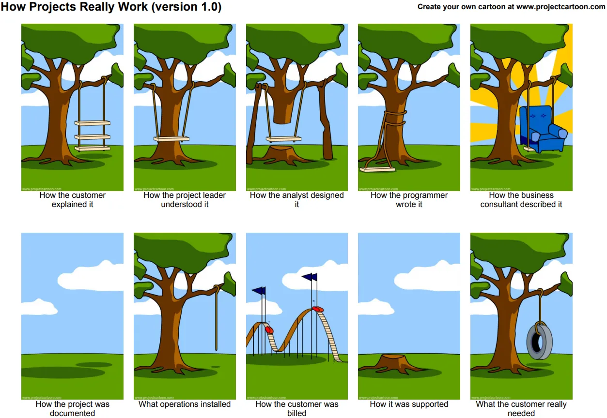

:::note[TL;DR]
Эта заметка вводит понятие модели и показывает, зачем модель нужна при проектировании ПО и ИС. Основной акцент сделан на том, что модель является упрощённым представлением объекта, выбранным под конкретную цель.
:::

Так зачем же нам нужно заниматься моделированием? В первую очередь любой софт пишется для решения чьих-то задач, и моделирование должно быть нацелено на обеспечение решения этих самых задач. Если возвращаться [к прошлому примеру](./01-intro), конура должна иметь четыре стены, в идеале не протекать во время дождя и защищать от ветра. Дом должен иметь планировку, которая устроит всех жильцов, при этом не должен развалиться за десять лет из-за плохого фундамента или сгореть из-за плохой проводки и легко воспламеняющихся материалов, по незнанию использованных в отделке. Офис визуально должен удовлетворять всех заказчиков и градозащитников, внутренняя планировка должна содержать все те приятные вещи, которые компании заявляют при найме (подземная парковка, спортзал, игровая комната с консолями, кухня с бесплатными сырками и кофе), само здание не должно быть подвержено влиянию внешних погодных условий (порывы сильного ветра, молнии, дожди, землетрясения). На каждом уровне свои требования, и эти требования определяют количество и качество разрабатываемых и документируемых моделей.

С другой стороны, чтобы задачи решались и сейчас, и в дальнейшем, программное обеспечение должно быть открыто к изменяющимся требованиям, а для этого нужно, во-первых, откуда-то получать эти самые требования (скорее всего, вам нужно будет периодически проводить интервью с пользователями), а во-вторых, сама архитектура программного обеспечения должна позволять относительно безболезненно эти требования воплощать в жизнь.

Модели в целом применяются не только в строительстве. Автомобили и самолёты требуют моделей разных уровней и исполнения, начиная с чертежей и заканчивая физическими моделями, проверяемыми на прочность. Гуманитарные дисциплины (экономика, социология, менеджмент) также применяют моделирование для проверки тех или иных идей без ущерба для окружающей среды.

В итоге **модель** — это упрощённое представление реальности, своеобразный чертёж. Модель может быть как детализированной, так и более абстрактной. В хорошей модели есть элементы, влияющие на результат, и нет элементов, которые в данный момент не столь значимы.

Ну и понятно, что и в случае со строительством, и в случае с разработкой ПО, основным этапом, предшествующим разработке, является проектирование модели ПО. Так зачем же в итоге нам нужны модели? Модели нам нужны, чтобы лучше понимать разрабатываемую систему с различных точек зрения (требований, процессов, архитектуры приложения) и в случае необходимости дополнять эту модель ещё до этапа реализации, когда внесение изменений будет более дорогим удовольствием.

