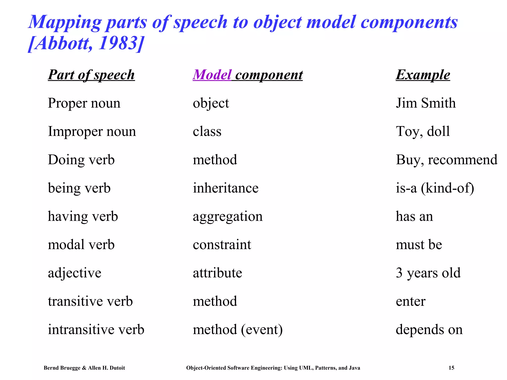
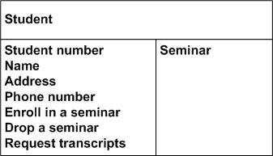
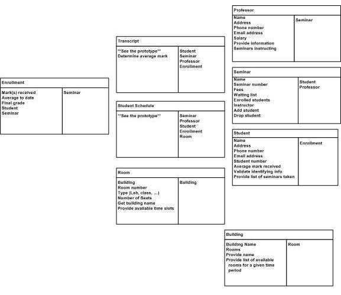

# Анализ и выделение классов

Как и раньше, перед тем, как заниматься диаграммой классов, необходимо понять, какие классы в целом нас интересуют. Для этого, на самом деле, есть некоторое количество методов, которые являются частным случаем объектно-ориентированного анализа и проектирования. **Объектно-ориентированное проектирование** разбивается на несколько этапов:

- Составление словаря предметной области, т.е. набора используемых понятий данной предметной области.
- Сопоставление классов проектируемой системы этим понятиям;
- Определение атрибутов, операций и связей между классами.

В идеальном мире в этих этапах участвуют не только разработчики и менеджеры, но и эксперты предметной области, которые не будут знать внутреннего устройства ИС с точки зрения программной архитектуры и ниже, но могут указать на полезные и неочевидные моменты, которые не видны обычным пользователям.

Методы в основном различаются именно тем, как эти этапы будут выполняться.

## Метод Аббота и метод именных групп

Метод Аббота ставит во главу угла само описание предметной области. Работает очень просто: определённые части речи отвечают за определённые категории понятий предметной области. Например, существительные будут кандидатами в классы, а глаголы — кандидатами для методов классов.

Метод именных групп похож на метод Аббота, но работает в основном с существительными.

Оба метода несовершенны в том плане, что предложения можно формулировать по-разному, и глагол может стать отглагольным существительным, например, и эти тонкости сильно зависят от естественного языка описания предметной области.

## Метод шаблонных классов

Метод шаблонных классов — это более формальный метод, основная суть которого — проанализировать существующие похожие системы и попробовать выделить классы, опираясь на заранее заданные категории и имеющийся опыт.

У разных авторов выделяются разные категории, мы же приведём более общий список:

- Транзакции;
- Элементы транзакций;
- Что-то, связанное с транзакциями или их элементами (над чем мы выполняем транзакции);
- Места записи транзакций;
- Каталоги и контейнеры других объектов;
- Содержимое контейнеров;
- Внешние системы;
- Запись деятельности (различные логи);
- Роли действующих лиц;
- Места транзакций (физические);
- Важные события, для которых нужно хранить время и место;
- Описания объектов;
- Руководства, документы и прочие материалы, на которые ссылаются в процессе работы.

## Метод карточек CRC

CRC-карточки (Class-Responsibility-Collaborators) — это ещё один простой способ сформировать словарь и сразу же выделить в нём атрибуты, операции и связи между различными терминами. Этот метод любят применять в командах, которые используют гибкие методологии разработки.

Сама по себе карточка выглядит следующим образом: сверху пишется название **класса**, в левой половине указывается, за какую информацию он отвечает и что он делает (**ответственность**), в правой половине указывается, какие классы нужны для реализации ответственности (**кооперация**).

Пример CRC-карточки

Карточки располагают рядом, причём чем сильнее связаны классы, тем ближе они должны быть.

Понятно, что это итеративный процесс, и после перетасовки карточек может всплыть ещё какая-то ответственность или даже класс, это нормально.

Пример нескольких упорядоченных карточек

При необходимости на карточках можно указывать и другую информацию, например, место в иерархии наследования. Единственное ограничение — карточки должны быть небольшими, чтобы стимулировать архитектора выделять только те детали, которые нужны на данном этапе. Также такое ограничение позволяет не раздувать классы, давая слишком много обязанностей.

Как мы увидим дальше, структура карточки и рекомендации к их компоновке сильно коррелируют с диаграммой классов, это, по сути, неформальный метод её описания.
